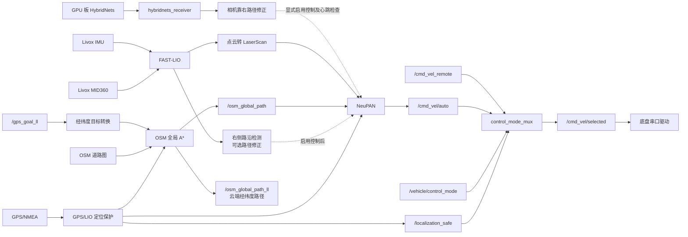

# 阿克曼无人车室外导航：项目架构与技术方案基线

> 本文档用于帮助理解 `/home/nuc/lxw/neupan_ws` 的整体结构、运行链路和主要函数职责。
>
> 项目基于 ROS1 Noetic。`src/` 是源码，`build/` 和 `devel/` 是 catkin 生成物，通常不应直接修改。
>
> 以下控制链路以 `neupan_ros/example/lxw_car/launch/full_system_run.launch` 为准；其他测试 launch 可能仍直接使用 `/neupan_cmd_vel`。这是静态代码分析，不能代替实车运行检查。
>
> 最近核对：2026-10-19；源码基线 `1aed6ca`。分析使用 codegraph 定位核心类、调用关系，再以源码及 launch 中的实际订阅、发布、参数和 remap 交叉核对。本文区分代码事实、分析判断和待实车验证项；不是实车验收报告。

## 全部问题索引与排查状态

本文是项目分析、问题清单和整改任务的统一文档。**当前只安排02、03修改；其他问题保留，不代表已经解决，也不自动授权执行。** 编号固定，后续可直接按编号讨论。

2026-10-19 本轮用户仅授权实施02；02已完成模拟串口修改与离线回归、待实车验证。03仍为后续任务，本轮未实施。

| 编号 | 问题/事项 | 当前状态 | 后续入口 |
| --- | --- | --- | --- |
| 01 | 速度指令失联停车 | 用户确认MCU已有保护，本轮不修改 | 保留确认记录；停止时间尚未测量 |
| 02 | 非法或过大的速度指令未统一拦截 | **已修改待验证：模拟串口通过，未实车验收** | 下文任务02实施记录，含默认值、入口核对与测试结果 |
| 03 | 求解结束后可能发布过期动作 | **待修改，当前重点** | 下文任务03，含时效、任务版本与回归要求 |
| 04 | 电机报警仅上报，不干预运动 | 用户确认属于预期设计，不整改 | 保持现状，不新增报警停车、降速或复位逻辑 |
| 05 | 非Fixed定位的绝对精度缺少验证 | 待验证 | 后文05排查记录 |
| 06 | GPS天线位置与车辆参考点可能不一致 | 待测量、待评估 | 后文06排查记录 |
| 07 | 路网可达不等于车辆可通行 | 待验证 | 后文07排查记录 |
| 08 | 相机路径回退后的横向连续性 | 待验证 | 后文08排查记录 |
| 09 | 自动恢复与人工接管规则 | 待明确需求 | 后文09排查记录 |
| 10 | 云端任务身份与状态契约 | 待核对云端实现 | 后文10排查记录 |
| 11 | 部署与实车验收基线 | 待完善 | 后文11排查记录 |

01的MCU能力来自用户于2026-10-19的确认，本次未审查固件或测量停止距离。04是用户明确的设计选择，不作为软件缺陷。02已有代码与离线测试，03目前仍为任务说明，不能将文档更新当成03修复完成。

## 当前执行任务：仅02和03

> 2026-10-19确认：01已有MCU失联停车，04仅报警是预期设计，均不整改。本轮仅实施02；03的要求原样保留，尚未修改。
>
> 本文件统一维护项目分析、问题依据和执行要求。交给其他模型时，先阅读本节；后面的风险分析不自动扩大本轮修改范围。

### 一、已确认的范围

| 原编号 | 当前决定 | 说明 |
| --- | --- | --- |
| 01：指令失联停车 | 不纳入本轮修改 | 用户确认：MCU未接收到速度指令会停止。无需以“MCU没有保护”为前提重复整改；具体超时时间及停止距离尚未在本轮测量 |
| 02：非法速度输入 | **已修改待实车验证** | 最终发送层拒绝NaN/Inf并约束越界指令，离线验收结果见下文 |
| 03：过期求解动作 | **需要修改** | 旧观测或旧任务的求解结果不能重新作为新动作放行 |
| 04：电机报警联锁 | **不修改，保持设计** | 用户明确要求只报警，不据此自动停车、降速或新增复位逻辑 |
| 05～11 | 本轮不实施 | 保留为后续分析和验证事项，不随本次任务扩展修改 |

执行顺序：先02，再03，分别提交可审查的修改与测试结果。不修改MCU协议、电机报警策略、GPS定位策略、OSM规划算法或NeuPAN优化算法。

### 二、任务02：非法速度输入保护

#### 1. 要解决的问题

整改前底盘驱动直接读取 `Twist.linear.x` 和 `Twist.angular.z`。已有转角限幅和速度死区，但没有统一的非有限数检查及纵向速度上限。本轮实现见本任务第6小节。

原回调离线验证曾生成：

| 输入 | 整改前输出 | 期望行为 |
| --- | --- | --- |
| 速度NaN | `CMD,nan,...` | 立即发送合法零速度/零转角，并记录拒绝原因 |
| 转角NaN | `CMD,...,nan` | 同上，不允许残留非零速度 |
| 任一控制字段为正负Inf | 可能进入换算或限幅 | 换算前拒绝，发送合法停车命令 |
| 有限但过大的速度 | 按原值换算轮速 | 按明确的正向/反向速度边界限幅 |
| 正常范围内输入 | 正常换算 | 保持原有行为 |

上述验证使用模拟串口，没有向实车发送命令。

#### 2. 修改位置

- 主要实现：[base_driver_node.py](src/robot_base_driver/scripts/base_driver_node.py) 的 `cmd_vel_callback`、`send_serial_command`。
- 参数接入：[driver.launch](src/robot_base_driver/launch/driver.launch)、[navigation_core.launch](src/robot_base_driver/launch/navigation_core.launch)，以及需要向用户开放覆盖的完整启动入口。
- 测试位置：`src/robot_base_driver/tests/`。

最终保护必须落在底盘驱动，不能只改mux而让其他直接调用驱动的入口绕过保护。

#### 3. 必须实现的行为

1. 在死区、单位转换和限幅之前，对实际使用的速度及转角执行有限数检查。
2. 任一控制字段非法时，发送合法停车命令；不能仅忽略消息而让上一条运动指令继续执行。
3. 增加可配置的正向/反向速度限制，保留现有转角限制；明确参数单位和取值范围。
4. 检查轮半径和新限幅参数是否合法；错误配置应阻止进入正常控制，不能产生除零、NaN或无穷大的协议字段。
5. 串口发送边界不得允许非有限数穿透；告警需节流，避免每帧刷屏。
6. 自动与手动指令均受到相同的最终检查。正常指令保持 `linear.x=m/s`、`angular.z=前轮转角rad`，MCU协议仍为轮速rad/s和转角deg。
7. 保留现有低速死区、停车回正以及电机仅报警行为。

#### 4. 参数与范围约束

- 当前室外规划配置的纵向上限为1.5 m/s，但这不是已经验证的硬件安全速度。执行模型须核对所有实车入口，明确提出参数默认值及兼容性依据，不能凭空认定实车最大速度。
- 保留项目需要的倒车能力；正反向边界应分别说明，不能顺手禁止倒车。
- **本轮先做输入合法性与幅值限制。** 加速度/转角变化率限制涉及控制动态，暂不与本项捆绑，后续有数据再单独设计。
- 所有停车请求必须能立即输出零速度，不得因新增平滑逻辑延迟。

#### 5. 验收要求

使用模拟串口和原控制逻辑进行测试，不启动实车：

- 覆盖速度/转角分别为NaN、+Inf、-Inf及两者同时非法。
- 覆盖正向超限、反向超限、边界值、正常速度及零速度。
- 覆盖现有0.05 m/s死区和±25°转角边界行为。
- 覆盖非法轮半径、非法限幅参数。
- 所有送往模拟串口的控制字段均为有限数，非法指令产生停车输出。
- 电机报警状态不能因本次修改新增自动停车或降速行为。

#### 6. 任务02实施记录（2026-10-19）

**状态：已修改待实车验证。** 只修改最终输入保护，不实施03，不新增MCU失联保护、电机报警联锁或加速度/转角变化率限制。

修改文件：`base_driver_node.py`，`driver.launch`，`navigation_core.launch`，`full_system_run.launch`，以及 `tests/test_base_driver_command_limits.py`。本文件和底盘包README同步说明行为。

| 参数 | 默认值 | 单位及合法范围 |
| --- | --- | --- |
| `max_forward_speed_mps` | 1.5 | m/s，有限且严格大于0；正向速度上限 |
| `max_reverse_speed_mps` | 1.5 | m/s，有限且严格大于0；反向速度绝对值上限，保留倒车 |
| `wheel_radius` | 0.1275 | m，有限且严格大于0；速度上限换算成rad/s后也必须有限且大于0 |

取值依据是当前室外YAML `max_speed[0]=1.5` 且原规划约束允许正反向对称幅值；室内YAML为1.0，TEB默认前进0.8/倒车0.45，开环默认0.4且自带1.0上限，均低于新的底盘默认限幅。这是软件默认值，不是硬件安全极速或倒车速度验收结论。旧 `neupan_lxwcar.launch` 的 `max_linear_speed=2.0` 未接入这个驱动的速度限幅；其实际默认规划YAML上限为1.0，不能将该旧参数当作已验证的2.0 m/s需求。显式发送超过1.5的旧直接控制指令现在会被限幅，这是预期变化。

已解析核对8个实车入口：底盘 `driver.launch`、`navigation_core.launch`、NeuPAN全系统（室内/室外）、`neupan_lxwcar.launch`、`neupan_lxwcar_norviz.launch`、`outdoor_global_only_test.launch`、TEB室外入口和开环录制入口。后5个旧入口无需改代码也继承底盘默认保护；直接底盘、定位入口及全系统入口开放正反向限幅覆盖，实际参数均到达 `/robot_base_driver`，不能通过绕过mux规避保护。

- `cmd_vel_callback` 在死区、单位换算之前检查实际使用的两个控制字段；任一非法就立即调用合法零速度/零转角发送，不忽略消息。有限大值按正反向速度和原±25°转角边界限幅，再进行单位转换。
- `send_serial_command` 独立复查有限性与幅值，防止直接调用绕过回调。协议仍为 `CMD,<轮速rad/s>,<转角deg>`；0.01 rad/s协议精度在限值附近向内量化，避免四舍五入越过配置上限。数值型非法和越界告警使用2秒节流。
- 参数在打开串口、安装订阅前校验；零、负数、NaN/Inf、布尔值、非数值以及导致换算溢出/下溢的配置报错退出，不进入正常控制。参数初始化时读取，修改需重启对应节点。
- 保留0.05 m/s死区、停车回正、正常范围内的原单位换算；自动、手动和直接发布速度均经过同一最终保护。电机报警仍只上报，不新增停车或降速。

测试在既有Neupan容器的ROS1 Noetic环境执行，不安装新Python库、不重启现有系统、不打开真实串口、不向实车发送速度；原串口对象由mock代替，launch仅解析参数、不启动节点。

```bash
cd /home/nuc/lxw/neupan_ws
source /opt/ros/noetic/setup.bash
source devel/setup.bash
PYTHONDONTWRITEBYTECODE=1 /usr/bin/python3 -m unittest discover \
  -s src/robot_base_driver/tests -p 'test_base_driver_command_limits.py' -q
```

新增21项测试全部通过，覆盖要求中的非法数矩阵、正反向边界、正常换算、死区、转角、非法参数、模拟串口输出、自动/手动路径、电机仅报警以及8个入口参数解析，并增加500组固定随机输入检查。底盘全量100项运行：98通过、2项隔离ROS节点联调主动跳过；OSM/相机/规划回归101项：100通过、1项ROS节点联调主动跳过（实际共享C++搜索测试开启）。合计198通过、3跳过，无失败。

本轮没有启动这些ROS节点联调，没有重建catkin、Gazebo或实车验收。仍需确认实际正反向限速、轮半径、转向幅值、串口量化对低速执行的影响；MCU失联停车时间/距离也仍属用户已有能力，未在本轮测量。任务03、GPS策略、OSM/NeuPAN算法和电机报警策略未改。

### 三、任务03：过期求解结果拦截

#### 1. 要解决的问题

当前流程大致为：

```text
检查扫描健康 → 读取输入并求解 → 发布求解动作
```

如果求解很慢，期间mux可能先因自动指令超时停车；当求解终于返回，旧结果又作为刚收到的新指令被放行。求解期间收到新目标时，也需要防止旧任务动作继续发布。

MCU失联停车不能替代此保护：迟到动作仍是一条刚收到的速度消息。

#### 2. 修改位置

- 主要实现：[neupan_core.py](src/neupan_ros/src/neupan_core.py) 的 `run`，以及目标/路径更新的排队与装载逻辑。
- 配置接入：[full_system_run.launch](src/neupan_ros/example/lxw_car/launch/full_system_run.launch) 和相关参数读取处。
- 测试可放在 `src/Test/tests/`；使用模拟求解器和可控时间，不依赖真实优化器耗时。

#### 3. 必须实现的行为

1. 求解开始前，记录实际使用的输入时间、单调时钟起点和当前有效任务/路径版本。
2. 结果发布前检查：求解结果是否超期、所用感知是否过旧、扫描是否仍健康、是否已有使本次结果失效的新目标/路径事件。
3. 任一检查失败，丢弃非零动作并发布零速度；不能把该次结果的到达状态当作新任务完成，也不能推进不再适用的连接段状态。
4. 时间期限使用单调时钟测量计算耗时；ROS采集时间用于传感器年龄判断。新扫描到达不能把本次实际使用的旧扫描“刷新”为新输入。
5. 保持现有线程职责：回调缓存更新，主循环装载路径；不能在订阅回调中并发重置求解器。
6. 不以“收到任意路径消息”作为失效条件。重复路径、相机心跳和无实际变化的参考线不应导致持续停车。
7. 状态输出区分结果超期、输入过旧、任务已变等原因，并记录求解耗时、拒绝次数或等效可诊断信息。
8. 恢复时只能使用当前任务、当前有效输入重新计算的合格结果，不重新发送被拒绝的旧动作。

#### 4. 参数与范围约束

- 增加明确的结果有效期限参数；数值应结合当前自动源超时0.5秒、扫描超时0.5秒及实际求解耗时确定并说明。
- 名义50 Hz循环不代表所有求解都能在20毫秒完成，不能未经验证直接以20毫秒作为停车门限。
- 本项是“返回结果的发布准入”，并不承诺强制中断卡住的求解器。求解期间继续依靠现有mux超时和MCU失联保护。
- 不改NeuPAN优化目标、权重、模型或求解算法；不新增电机报警停车。
- 处理任务版本与发布检查之间的并发窗口，明确一次动作发布与目标更新的先后规则。

#### 5. 验收要求

用模拟时间与模拟求解器验证：

| 场景 | 必须结果 |
| --- | --- |
| 正常耗时、输入健康、任务未变 | 原有正常动作可发布 |
| 求解超出有效期限 | 发布零速度，拒绝迟到动作 |
| 求解期间扫描失效 | 结果不放行 |
| 求解期间来了新扫描，但本次所用扫描已过旧 | 不能仅凭新扫描健康放行旧结果 |
| 求解期间收到使旧任务失效的新目标 | 不发布旧动作，不把旧到达状态作用于新任务 |
| 重复发布同一条路径 | 不造成永久停车或反复重置 |
| 过期结果拒绝后，下一次正常求解 | 可按现有任务规则恢复，不重放旧结果 |
| 系统时钟调整 | 单调计时的求解期限判断不受影响 |

03完成后，回归现有目标切换、相机路径监督和掉头连接测试，确认未破坏已有状态流转。

### 四、执行模型的交付要求

每项任务分别提供：

1. 修改文件、行为变化和参数默认值说明。
2. 测试命令、通过/失败/跳过结果及未覆盖部分。
3. 对正常自动、手动、停车和倒车行为的兼容性说明。
4. 需要实车确认的项目；不得将离线通过写成实车验收完成。

先检查仓库当前状态及适用的AGENTS.md，保留已有工作区修改。不要启动车辆、发送速度、修改串口配置或MCU固件。不要顺带实施01、04或05～11。完成后由技术负责人审查，再安排实车验证。

---

## 后续问题排查记录：05～11

这些条目完整保留供下次排查。本轮不实施修改；先收集证据，再决定是否需要改代码。

### 05. 非Fixed定位的绝对精度

- **现状与依据**：`global_odom_bridge.py` 的 `update_runtime_position` 允许合格Float/差分位置校正平移，并更新续推预算。
- **需要排查**：稳定但存在偏差的位置也可能通过一致性检查；内部残差不是绝对定位误差，平移校正也不等于消除航向漂移。
- **下一步**：用独立位置基准，对比Fixed、Float、完全失锁和恢复阶段的横向、航向、终点误差，并记录预算更新时刻。
- **判定依据**：按道路宽度和运行净距确定可接受误差；不能仅凭“未触发100米/600秒停车”判断定位可靠。

### 06. GPS天线与车辆参考点

- **现状与依据**：`gps_fix_to_map_odom.py` 直接投影天线经纬度，默认输出为 `base_link`；该处没有水平杆臂补偿。
- **需要排查**：实际天线与车辆参考点是否有水平偏移。若有，误差可能随车辆朝向变化；存在静态TF不代表这里自动做了补偿。
- **下一步**：确认 `base_link` 的物理位置，测量天线安装尺寸，核对规划器车体参考点。
- **判定依据**：比较不同朝向及转弯轨迹的位置误差，再决定是否补偿，不能凭代码直接猜测实车误差大小。

### 07. 道路路线与实车通行能力

- **现状与依据**：完整launch默认起终点吸附上限均为50米；OSM道路宽度可能来自估计值；普通跟踪没有掉头连接分支同等的完整车体扫掠准入。
- **需要排查**：当前位置到吸附道路的接入段、窄路、急弯、路口和单行限制是否符合实车能力。当前最大OSM右偏量为0，不能仅凭右偏开关认为参考线已经靠右。
- **下一步**：核对实际地图宽度与边界，用离路起步、远离道路目标、窄路及急弯场景复测。
- **判定依据**：分别记录路网搜索成功、路径可跟踪、车体可通行；三者不能混为一个成功状态。

### 08. 相机路径失效后的回退连续性

- **现状与依据**：`CameraPathGuard.select` 在相机心跳或路线校验不通过时回退原OSM路线，原路线无效则停车。
- **需要排查**：相机靠右路径与OSM路径存在横向差距时，回退是否导致明显转角或轨迹突变。
- **下一步**：在不同速度和横向偏移下，模拟断流、旧帧、错误路线、缓存失效，记录候选路径、原路径、最终控制和实际轨迹。
- **判定依据**：观察转角变化、横向偏差和边界净距；根据数据再决定平滑回退、降速或停车策略。

### 09. 自动恢复与人工接管规则

- **现状与依据**：`control_mode_mux.py` 手动切回自动时，可立即使用未超时的自动缓存指令；定位安全恢复也可重新放行；模式消息本身无心跳超时。
- **需要排查**：手动移动车辆后，继续旧任务是否符合操作要求；哪些恢复允许自动执行，哪些需要操作员确认。
- **下一步**：先明确恢复规则，再测试手动移车、遥控断线、定位恢复及节点重启。
- **判定依据**：行为符合已确定的操作规则且状态可解释；不能未经需求确认把自动恢复一律视为缺陷。

### 10. 云端任务身份与状态

- **现状与依据**：已审查的ROS接口中，`/goal_arrived` 为字符串0/1，经纬度路径JSON没有任务ID或时间戳，部分消息锁存。
- **需要排查**：云端是否已有机制区分旧任务、新任务、失败、取消和重试；本次未完整审查云端实现。
- **下一步**：核对接口契约，复现连续目标、乱序消息、失败重试、取消和断线重连。
- **判定依据**：旧消息不改变新任务状态，重试不导致重复执行，重连后两端任务状态一致。必要时再设计任务ID和状态协议。

### 11. 部署与实车验收基线

- **现状与依据**：本仓库ROS包装依赖外部NeuPAN包、模型、地图、标定文件和运行环境；已有部分离线测试，但尚不能据此认定当前版本完成实车验收。
- **需要排查**：是否能完整复现某次运行；调参效果是否有统一指标，而不仅是现场观感。
- **下一步**：记录Git提交、外部依赖版本、完整参数、地图/模型/外参哈希、原始数据、接管记录和测试条件。
- **判定依据**：同场景能重复比较横向误差、终点误差、净距、停车时间/距离、求解耗时及接管次数。已运行与未运行测试分别记录，详见第26节。

### 后续维护规则

每项统一更新为“待排查、待修改、已修改待验证、已验证或确认不整改”，并注明日期、依据和验证范围。保留01、04的用户决定；不要删除尚未处理的05～11，也不要把它们自动纳入02、03任务。

---

## 0. 技术负责人视角与使用约定

当前项目已具备室外导航的完整软件链路：GNSS/LIO/轮式里程计定位、OSM 路网规划、NeuPAN 局部优化、自动/手动仲裁和串口执行。近期工作主要集中在桥底定位退化、返程掉头、视觉靠右和故障可观测性。**软件机制存在不等于实车鲁棒性已验证**，后续方案应先锁定场景、配置和数据，再修改对应层。

- **主线入口**：[full_system_run.launch](src/neupan_ros/example/lxw_car/launch/full_system_run.launch)，室外必须显式 `outdoor_mode:=true`；文件默认仍为室内。
- **现场操作入口**：[核心启动指令.md](核心启动指令.md)；本文件描述架构及设计约束，避免维护第二套易漂移的现场命令。
- **源码职责**：[src/README.md](src/README.md)。OSM/路径准备归 `osm_map_handler`，局部优化归 `neupan_ros`，定位/底盘归 `robot_base_driver`。
- **事实优先级**：实际启动参数与运行数据 → 当前源码 → 包说明 → 历史调试记录。配置注释与数值不一致时，以运行参数为准。
- **方案边界**：MCU 固件、GPU 推理程序、云端任务服务并未在本次核心源码审查中形成完整闭环；不能从 ROS 接口反推它们已有看门狗、同步或任务重试机制。

后续快速定位：控制/任务看第 2、4、5 节；定位看第 2.9、5、23 节；视觉/掉头看第 2.8、2.10、6 节；参数、风险与验收看第 24～27 节。

## 1. 项目总体结构



系统可以分成六个层次：

1. **传感器层**：Livox、GPS、IMU；可选的相机和 GPU 板视觉接收。
2. **定位层**：FAST-LIO、GPS 投影、GPS/LIO 守门器、`map -> odom` 对齐。
3. **地图与全局规划层**：OSM 道路图、A*、Hybrid A*、栅格地图。
4. **局部规划与控制层**：NeuPAN 或室外直接路径跟踪器。
5. **底盘执行层**：串口底盘驱动。
6. **测试与可视化层**：RViz、日志、rosbag、路沿检测和 HybridNets 调试。

## 2. 关键运行链路

### 2.1 室内 NeuPAN

```text
Livox -> FAST-LIO -> /cloud_registered_body
      -> pointcloud_to_laserscan -> /scan

/odom 或 AMCL TF -> map -> base_link
/scan + TF + /initial_path
      -> neupan_core.py
      -> /cmd_vel/auto（本 launch 对 NeuPAN 输出的 remap）
      -> control_mode_mux.py（mode=0）
      -> /cmd_vel/selected
      -> base_driver_node.py
      -> MCU 串口
```

### 2.2 室外 NeuPAN

```text
GPS + FAST-LIO
      -> /odometry/gps、/odometry/local
      -> global_odom_bridge.py
      -> /odometry/global
      -> map_odom_align_bridge.py
      -> map -> odom TF

云端 /gps_goal_ll (sensor_msgs/NavSatFix)
      -> gps_goal_bridge.py -> /move_base_simple/goal (map 坐标)
      -> global_astar_node.cpp + OSM 道路图 + /odometry/global
      -> /osm_global_path (map 坐标，供 NeuPAN 跟踪)
      -> /osm_global_path_ll (经纬度 JSON，供云端显示)

/osm_global_path + /scan + TF -> neupan_core.py
      -> /cmd_vel/auto -> control_mode_mux.py（mode=0 且定位安全）
      -> /cmd_vel/selected -> base_driver_node.py -> MCU 串口
```

目标到达不等于立即运动：桥接节点会拒绝 NaN 经纬度和无效的 `NavSatFix.status.status`；A* 需要可用的全局里程计与 OSM 道路图，路径搜索也可能因道路吸附或不可达失败。NeuPAN 还需要有效扫描和 TF；自动模式下 `/localization_safe=false` 会使选择器输出零速度。

### 2.3 室外直接跟踪

```text
OSM A* -> /osm_global_path
       -> global_path_tracker.py
       -> /neupan_cmd_vel
       -> base_driver_node.py
```

这条测试链路不经过完整系统的 `control_mode_mux.py`。不要与完整系统同时启动同一个串口驱动或竞争同一底盘速度输入。

### 2.4 MID360 右侧路沿修正（可选）

```text
/cloud_registered_body -> lidar_curb_node.py
  -> /road_curb/lateral_error + /road_curb/status
  -> path_refine_node.py + /osm_global_path
  -> /osm_global_path_curb_refined
```

`enable_lidar_curb:=true` 只启动检测；还需 `enable_lidar_curb_control:=true` 才会把 NeuPAN 的初始路径切换到修正路径。默认两个开关都是 `false`。HybridNets 接收器自身不生成路径或底盘速度；其 JSON 已可经相机靠右模块间接影响控制，见 2.8 节。

### 2.5 云端接口与手动接管

| Topic | 类型 | 云端方向 | 用途 |
| --- | --- | --- | --- |
| `/gps/fix` | `sensor_msgs/NavSatFix` | 订阅 | 原始 GPS 经纬度；不等同于融合后的 `/odometry/global` |
| `/osm_global_path_ll` | `std_msgs/String` | 订阅 | `data` 为 `{"points":[{"latitude":23.0398,"longitude":113.39002},...]}` 的 JSON；默认仅云端简化，直线保留首尾、弯道保留必要形状点，不再与本地路径逐点对应 |
| `/gps_goal_ll` | `sensor_msgs/NavSatFix` | 发布 | 目标经纬度；默认拒绝 `status.status < 0` |
| `/vehicle/control_mode` | `std_msgs/UInt8` | 发布 | `0=AUTO`，`1=MANUAL`；默认 `0` |
| `/cmd_vel_remote` | `geometry_msgs/Twist` | 发布 | 云端手动速度；launch 把选择器内部 `/cmd_vel/remote` 订阅重映射到此 topic |
| `/vehicle/control_mode/status` | `std_msgs/String` | 订阅 | 当前模式及 `auto_active`、`remote_active`、`localization_unsafe` 等原因 |

自动时，NeuPAN 继续发布 `/cmd_vel/auto`，选择器仅在自动指令未超时且定位安全时转发；手动时 NeuPAN 不停止，但选择器只转发 `/cmd_vel_remote`。最终输出始终是 `/cmd_vel/selected`。自动/手动指令超时默认分别为 `0.5 s`/`1.0 s`，超时输出零速度。这里 `Twist.angular.z` 被底盘驱动解释为**前轮转向角（弧度）**，不是差速车的角速度。

完整系统把定位安全停车放在选择器的自动分支；手动模式不受 `/localization_safe` 拦截。使用 `use_global_ekf:=true` 时，本 launch 关闭选择器的这项定位门控；其他 launch 是否启用底盘自身的定位保护需单独检查。

模式消息与速度消息的超时处理不同：启动后从未收到模式消息时采用默认自动模式；收到有效模式后，即使模式发布端断开，也保留最后一次模式，不会自动切回自动。当前没有模式心跳超时。模式发布端应周期发布或使用 latch，以便新启动的订阅者取得当前模式。

### 2.6 控制状态的含义

| `status.data` 中的 `reason` | 实际行为 |
| --- | --- |
| `starting` | 节点刚启动；随后由定时器更新状态 |
| `auto_active` | 自动源及时且通过已启用的定位门控；仍可能转发零速度 |
| `auto_timeout` | 自动源不存在或超过自动超时，输出零速度 |
| `localization_unsafe` | 自动模式收到明确不安全状态，输出零速度 |
| `localization_safety_missing` | 门控已启用但尚未收到定位安全消息，输出零速度 |
| `localization_safety_timeout` | 定位安全心跳年龄达到默认 1 秒，输出零速度；旧的 true 不继续放行 |
| `remote_active` | 手动源及时，转发其速度；仍可能转发零速度 |
| `remote_timeout` | 手动源不存在或超过手动超时，输出零速度 |

状态话题为 latched JSON 字符串，包含 `mode`、`mode_name`、`reason`，以及速度源年龄、超时阈值、定位安全值和心跳年龄等字段；状态变化或每约 0.5 秒更新。定位心跳使用单调时钟计龄，速度源超时仍使用 ROS 时间。`active` 只表示速度源可用，不保证车辆正在运动；还需看 `/cmd_vel/selected` 的数值及串口执行情况。

### 2.7 连续目标与桥底再次出发

系统持续运行时，云端可以依次向 `/gps_goal_ll` 下发多个目标。NeuPAN 到达当前路径终点后持续发布零自动速度，并显示 `Goal reached; waiting for a new goal/path`；`/goal_arrived` 是 latched `std_msgs/String`，默认 2 Hz 发布 `"1"`。接收新的地图目标后先清除旧到达状态并发布 `"0"`，停车等待 A* 新路径；新路径由主循环统一装载和重置规划器，避免订阅回调与求解器同时修改路径。旧任务路径的重复发布不会重新启动已完成任务。

NeuPAN 终端会把“已到达并等待新目标”“新目标已接收、等待规划路径”“新路径已接受并开始下一段”等任务生命周期关键提示显示为黄色；等待 `base_link -> map` 或激光雷达坐标系到 `map` 的 TF 变换提示显示为红色，便于现场观察。颜色只用于终端显示，不写入综合 JSONL 日志的数据字段。

完整系统启动时，Livox SDK 的常规初始化和 `Data Handler` 等驱动输出写入 ROS 日志文件，不持续占用综合启动终端；单独启动 `rviz_MID360.launch` 时默认仍输出到屏幕，方便驱动调试。NeuPAN 的雷达 TF 等待、雷达失效安全停车和障碍物触发停车继续在综合启动终端周期提示，不受该设置影响。

首次启动仍需稳定 GPS 建立定位基准；到达后不重启系统，新目标不会重置 `global_odom_bridge`。桥底 GPS 非 Fixed 时可使用已初始化的全局变换和本地里程计继续规划、行驶，但本地里程计、TF、LaserScan 与定位安全状态仍必须正常，续推预算也不能超限。保存并冻结上一次终点坐标不能替代当前本地里程计位置。

### 2.8 相机靠右路径：当前已有可选控制链

```text
/hybridnets/result_json + 原始 OSM 路径 + 采集时刻 TF + 相机标定
  -> camera_right_path.py -> osm_camera_path_refinement.CameraRightPath
  -> /camera_right/control_path + /camera_right/status
  -> neupan_core 内的 CameraPathGuard
  -> NeuPAN 局部优化 -> /cmd_vel/auto
```

`enable_camera_right_path=false`、`enable_camera_right_control=false` 是完整系统默认值；仅启用验证路径不接管控制。路径选择优先级为：相机控制路径 > 路沿修正路径 > `outdoor_initial_path_topic`。同时开启两个控制开关并不代表融合了两个感知源。

默认 `strategy=segment_cache`，按道路段确认和缓存；另有 `realtime` 策略。当前默认距离基准为 `camera_center`，相机光学中心距右边界的平面横向目标距离为 2.0 米，并非右轮净距 2 米。轮距、胎宽和 `base_link` 高度分别影响不同的几何换算，不能混用。

消费进程中的 `CameraPathGuard.select` 独立核对原路线、候选路线 frame/时间戳、心跳确认的路径摘要和 3 秒心跳期限。过期或不匹配回退原路线；原路线也无效则停车。生产端依赖真实采集时间和当时 TF；“网络持续收到 JSON”不等于观测有效。此机制仍依赖 NeuPAN 进程本身正常运行。

### 2.9 定位退化：启动、运行校正、完全失锁分开处理

| 阶段/模式 | 当前策略 | 关键边界 |
| --- | --- | --- |
| 默认初始化 | 高质量位置与固定有效双天线航向，稳定确认 | 无定位基准时不能凭空进入桥底续推 |
| `low_precision_startup=true` | 放宽初始位置，仍要求固定有效航向 | 粗起点会引入地图平移误差 |
| Fixed 正常跟踪/恢复 | 质量、跳变、稳定窗口和平滑校正 | 不以一帧 Fixed 直接重置预算 |
| 运行中位置校正 | 默认 `gps_guard_allow_nonfixed_runtime=true`，接受合格 GGA 2/4/5，仅校正平移 | 保留 `map -> odom` 航向；车辆航向继续由本地里程计演进 |
| 完全失锁/不合格位置 | 本地续推，默认最近合格更新后的 100 米/600 秒预算 | 单点 GGA=1 不参与运行中位置校正；任一预算超限停自动 |

运行中位置校正默认要求：已初始化、已知水平协方差 ≤4 m²、HDOP≤2.5、卫星≥8、稳定窗口≥5 秒、候选平移散布≤0.75 米、与当前变换创新≤3 米；校正速度≤0.10 m/s。残差≤0.5 米后最多每稳定窗口更新一次续推预算。这里的残差是候选变换一致性，**不是实测绝对定位误差**。

源码调用链：`timer_cb -> update_guard -> data_quality(..., runtime_position=True) -> update_runtime_position -> RuntimePositionWindow.observe / move_transform_toward`。重复源时间戳不能作为新观测。查看 `/gps_guard/status` 的 `runtime_position`、`global_reference_precision` 和 `last_processed_gps_source_ns`；持续合格粗位置可能支持远超 100 米的运行，需单独评价绝对误差和道路对齐。

### 2.10 返程掉头：局部连接，不是整条路的 Hybrid A*

主线默认启用 `enable_outdoor_start_connector=true`，在室外 OSM 直连分支且原始路径话题为 `/osm_global_path` 时生效。新路线接入方向与车头夹角至少 135° 才触发前进掉头连接；普通起步、90° 转弯和同向偏移继续交给原 NeuPAN 跟踪。

`StartRouteConnector -> CppHybridSearch -> outdoor_hybrid_worker -> hybrid_astar/HYAS` 使用共享 C++ 搜索核心。局部地图 16×16 米、分辨率 0.1 米，默认搜索预算 1 秒/12000 次迭代；等待搜索时输出零速度，返回后还检查最新扫描、采集时刻 TF、车体扫掠和道路范围。未知观测不能作为掉头空地；失败不会自动倒车或放行反向路线。

状态在 `/neupan/route_connection`：`searching`、`connecting`、`following_route`、`blocked`。旧 `outdoor_use_hybrid_astar=false` 保持不变；开启它会选择另一条整段栅格分支。普通跟踪没有经过掉头分支同等的完整扫掠准入，不能把局部检查扩展解释为全程通行认证。

## 3. 根目录文件夹

### `src/`

所有 ROS 包和第三方源码的集合，是项目源码的主要入口。

### `build/`

catkin 编译目录，包含 CMake 缓存、构建规则、中间文件和生成的包构建目录。不要在这里修改源码。

### `devel/`

catkin 开发环境，包含 `setup.bash`、环境变量、Python 路径、动态库和 ROS 包索引。

### `bags/`

可自行创建的 rosbag 数据目录；当前工作区根目录没有该文件夹。录制话题配置位于 `src/vehicle_bag_recorder/config/vehicle_data.yaml`。

### `tracker_logs/`

系统运行 JSONL 日志，记录 GPS、定位、路径、控制和安全状态。

### 根目录 Markdown

- `README.md`：项目总体说明。
- `GDUT室外导航.md`：室外导航部署记录和说明。

## 4. `src/neupan_ros`

NeuPAN 的 ROS1 封装和示例工程。

### `src/neupan_ros/src/neupan_core.py`

核心类是 `neupan_core`。

- `__init__`：初始化 ROS 节点，读取规划器、LaserScan、TF、自车过滤和安全参数；加载 NeuPAN 配置；建立发布器和订阅器。
- `run`：名义 50 Hz 主循环（实际频率受求解与发布耗时影响）。读取 `map -> base_link` TF，检查路径和扫描健康状态，调用 NeuPAN，发布速度、路径、参考状态和 RViz Marker。
- `parse_adjust_profile`：把字符串形式的五元调参配置解析成 NumPy 数组。
- `mark_scan_valid`：记录扫描恢复时间和当前有效模式。
- `mark_scan_fault`：记录扫描故障并进入 `FAULT` 状态。
- `scan_is_healthy`：检查扫描是否存在、是否超时、TF 是否有效、是否已经稳定恢复。
- `publish_scan_health`：以 JSON 字符串发布 `/neupan/scan_health`。
- `compute_min_obstacle_distance`：计算机器人前方指定角度范围内的最近障碍距离。
- `update_adaptive_adjust_parameters`：按最近障碍距离，在 clear 和 avoid 两组 NeuPAN 参数之间插值。
- `scan_callback`：过滤无效距离、按角度和距离筛选、降采样，并把雷达点从 `lidar_frame` 转换到地图坐标。
- `path_callback`：接收完整 `nav_msgs/Path` 并准备路径更新；实际规划器装载在主循环执行，涉及相机路径监督和室外掉头连接，不能在回调中与求解并发重置。
- `waypoints_callback`：从机器人当前位置和多个航点生成规划初始路径。
- `goal_callback`：从当前位姿和目标 Pose 生成规划初始路径。
- `quat_to_yaw_list`：将四元数数组转换为偏航角。
- `quat_to_yaw`：将 ROS Quaternion 转换为偏航角。
- `yaw_to_quat`：将偏航角转换为 ROS Quaternion。
- `generate_path_msg`：把 NeuPAN 内部路径转换成 `nav_msgs/Path`。
- `generate_twist_msg`：把 NeuPAN 动作转换成 `geometry_msgs/Twist`；到达或停止时输出零速度。
- `generate_dune_points_markers_msg`：发布 DUNE 点集 MarkerArray。
- `generate_nrmp_points_markers_msg`：发布 NRMP 点集 MarkerArray。
- `generate_robot_marker_msg`：根据机器人尺寸和运动学生成 RViz 车体 Marker。

主要输入话题：`/scan`、`/initial_path`、`/neupan_waypoints`、`/neupan_goal`。

主要输出话题：`/neupan_cmd_vel`、`/neupan_plan`、`/neupan_initial_path`、`/neupan_ref_state`、`/dune_point_markers`、`/nrmp_point_markers`、`/robot_marker`、`/neupan/scan_health`。

### `src/neupan_ros/scripts/neupan_node.py`

程序入口。实例化 `neupan_core`，然后调用 `run()`；异常时调用 `neupan_diagnostics.report_failure` 保存诊断后重抛。诊断包括异常栈、配置/模型路径、规划阶段、数值输入与路径进度，不等于求解器已自动恢复。

### `example/lxw_car`

真实阿克曼车辆示例。

- `config/neupan_config.yaml`：旧版默认配置入口。
- `config/neupan_config_indoor.yaml`：室内 NeuPAN 参数。
- `config/neupan_config_outdoor.yaml`：室外较保守参数。
- `config/neupan_train.yaml`：DUNE 训练参数。
- `dune_train_lxw_car.py`：加载训练配置并调用 `train_dune()`。
- `launch/neupan_lxwcar.launch`：真实车辆基础启动，包含底盘、FAST-LIO、Livox、点云转 LaserScan 和 NeuPAN。
- `launch/full_system_run.launch`：完整室内/室外系统入口，包含定位、GPS 经纬度目标桥接、OSM A*、NeuPAN、自动/手动速度选择、底盘，以及可选的路沿检测与 HybridNets 接收。
- `launch/outdoor_global_only_test.launch`：只测试室外定位和 OSM 全局规划。

### `example/lxw_car_simulation`

阿克曼车辆 Gazebo 仿真。

- `config/neupan_config_sim.yaml`：仿真规划参数。
- `scripts/ackermann_sim_driver.py`：接收速度指令，按阿克曼模型更新 Gazebo 车辆状态，发布里程计和 TF。
- `scripts/publish_demo_goal.py`：延时发布仿真目标。
- `launch/lxw_car_simulation.launch`：仿真总入口。
- `launch/neupan_lxwcar_gazebo.launch`：启动 Gazebo、车辆模型、RVO 动态障碍、仿真驱动、NeuPAN 和 RViz。
- `worlds/`、`models/`、`urdf/`、`rviz/`：仿真环境、车辆模型、机器人描述和显示配置。

### `example/gazebo_limo`

Limo 差速车仿真。

- `config/neupan_planner_limo.yaml`：循环路径配置。
- `config/neupan_planner_limo_noloop.yaml`：非循环路径配置。
- `dune_train_limo.yaml`：Limo DUNE 训练参数。
- `dune_train_limo.py`：Limo DUNE 训练入口。
- `launch/neupan_gazebo_limo.launch`：启动 NeuPAN 和 RViz。
- `launch/neupan_gazebo_limo_noloop.launch`：非循环版本。
- `launch/gazebo_limo_env_complex_20.launch`：启动复杂 Gazebo 环境和 RVO 动态障碍。
- `launch/run_limo_rviz.launch`：只启动模型状态发布和 RViz。

## 5. `src/robot_base_driver`

负责底盘串口、里程计、定位保护、路径跟踪和系统日志。

### `scripts/base_driver_node.py`

- `RobotBaseDriver.__init__`：读取串口、车体和安全参数，打开串口，建立速度订阅、里程计发布和 TF 广播；速度订阅由 `~cmd_topic` 指定，完整系统配置为 `/cmd_vel/selected`。
- `cmd_vel_callback`：先拒绝非法控制字段、限制正反向速度及±25°转角，再把 `Twist.linear.x`（m/s）和 `Twist.angular.z`（转向角，rad）转换为 MCU 协议 `CMD,<轮速 rad/s>,<转角 deg>`；保留速度死区和停车回正，见任务02。
- `localization_safety_callback`：仅当本节点的 `~enable_localization_safety_stop=true` 时，定位不安全立即发送停车命令。完整系统将该参数设为 `false`，改由控制模式选择器仅保护自动模式；其他 launch 可有不同设置。
- `send_serial_command`：独立复查数值有限性和幅值，拒绝时发送零速/零转角；按协议精度向内处理速度边界，格式化并写入串口。
- `read_from_mcu` / `handle_mcu_line`：分流 `ODO` 和 `MOTOR` 报文；`handle_odom` 计算相对位姿及内部速度估计，但当前发布的 `/odom.twist` 两个速度分量仍为零。本地 EKF 使用位姿，并不融合这些零速度。
- `parse_motor_telemetry` / `handle_motor_line`：解析左右电机扭矩、MOS/线圈温度及状态，发布 `/motor/status`、`/motor/alarm`、`/diagnostics`；报警带回差。当前报警只上报，未在该驱动速度回调中形成停车联锁；用户于2026-10-19确认这是预期设计，不执行报警联锁整改。
- 主循环：持续读取 MCU 数据并发布 `/odom`，必要时发布 `odom -> base_link` TF。

### `scripts/control_mode_mux.py`

- 订阅 `/vehicle/control_mode`、`/cmd_vel/auto` 和内部名称 `/cmd_vel/remote`。完整系统用 ROS remap 将后者接到云端 `/cmd_vel_remote`，不会额外创建 `/cmd_vel/remote` 发布话题。
- `AUTO=0`：选择 NeuPAN 自动速度；完整系统在 `use_global_ekf:=false` 的室外配置下同时检查 `/localization_safe`。定位不安全时立即输出零速度并报告 `localization_unsafe`。
- `MANUAL=1`：选择云端手动速度，不受定位安全状态拦截；超过默认 `1.0 s` 没有新遥控消息则输出零速度。
- 以约 20 Hz 发布选定速度到 `/cmd_vel/selected`，并在状态变化或每约 0.5 秒发布 JSON 状态到 `/vehicle/control_mode/status`。无模式消息时采用 launch 默认的 `0=AUTO`；非法模式值会被忽略。

### `scripts/global_path_tracker.py`

室外不经过 NeuPAN 的直接路径跟踪器。

- `clamp`：限制数值范围。
- `wrap_to_pi`：把角度归一化到 $[-\pi, \pi]$。
- `GlobalPathTracker.__init__`：读取路径、里程计、目标、前视、速度、转角和停车参数。
- `path_callback`：缓存 `/osm_global_path`，计算路径累计长度并重置目标状态。
- `odom_callback`：接收全局里程计并提取位姿。
- `update_tf_pose`：当启用 TF 模式时读取当前机器人位姿。
- `goal_callback`：记录 RViz 点击目标。
- `publish_stop`：发布零速度。
- `_record_debug_sample`：发布 JSON 调试状态。
- `compute_cumulative_lengths`：计算路径每个点的累计弧长。
- `project_onto_path`：将机器人投影到最近路径段，得到横向误差、弧长和剩余距离。
- `segment_heading_at_projection`：计算投影位置处的路径切线方向。
- `find_target_point`：根据前视距离找到跟踪目标点。
- `should_stop_at_goal`：结合点击目标、路径末端和越界条件判断是否停车。
- 控制循环中的控制计算：根据横向误差和航向误差计算 Ackermann 转角，根据距离目标的远近调整速度。

### `scripts/gps_fix_to_map_odom.py`

- `latlon_to_xy`：把经纬度转换到以 datum 为原点的局部平面坐标。
- `fix_cb`：缓存 `NavSatFix`。
- `heading_cb`：缓存航向。
- `build_covariance`：从 GPS 协方差构造里程计协方差。
- `timer_cb`：周期发布 `/odometry/gps`。

### `scripts/global_odom_bridge.py`

GPS 与 FAST-LIO 的全局定位安全守门器。

- GPS、LIO、GGA、航向回调：缓存各类定位和质量数据。
- `data_quality`：检查 fix 状态、GGA 质量、卫星数、HDOP 和位置协方差。
- `candidate_transform`：根据 GPS 与局部里程计计算候选 `map -> odom` 变换。
- `transform_error`：计算候选变换与当前变换的误差。
- `candidates_consistent`：检查连续候选是否稳定一致。
- `append_recovery_candidate`：加入 GPS 恢复候选窗口。
- `recovery_window_stable`：判断恢复窗口是否满足稳定时间。
- `set_mode`：切换 GPS 跟踪、GPS 丢失、本地续推和恢复状态。
- `update_guard`：更新 GPS 跟踪、丢失、本地续推等状态；定时回调随后发布 `/odometry/global`、`/gps_guard/status` 和 `/localization_safe`。

`localization_is_safe` 的条件是：全局与本地变换已初始化、本地里程计未超时、已过本地异常观察期，并且本地续推距离和时间预算未超限。GPS 暂时失锁后，如果已初始化且本地续推正常，定位安全状态仍可能为 `true`；它不等价于“此刻 GPS 必须为 RTK Fixed”。启动时缺少 GPS 或本地里程计则无法完成初始化。

续推试运行限制默认是累计路程 100 米或持续 600 秒（10 分钟），任一达到便将 `/localization_safe` 置为 `false`；这只是限制未校正里程计累积时间/距离，不能保证实际漂移小于某个米数。停车等待也计时，路程按每次本地位姿增量累计，因此往返运动不能抵消；新目标、到达、短暂 GPS Fixed 和里程计原点重置都不会清零预算。可信 GPS 初始化或平滑恢复到 `GPS_TRACKING` 会重置预算；当前默认开启的运行中位置校正也可在稳定窗口和残差条件满足后更新预算，见 2.9 节。不能再将 100 米理解成“无 Fixed 的总里程上限”。距离和时间需用现场数据调整。

### `scripts/lio_odom_guard.py`

FAST-LIO 输出保护器。

- `pose_from_odom`：提取里程计位置和偏航角。
- `assess_motion`：检查平面速度、横向速度、角速度和采样间隔。
- `apply_offset`：对 LIO 位姿施加当前对齐偏移。
- `align_offset`：重新计算 LIO 与轮速之间的偏移。
- `wheel_extrapolated_target`：根据轮速里程计外推目标位姿。
- `publish_corrected`：发布保护后的 LIO 里程计。
- `lio_cb`、`wheel_cb`：处理 FAST-LIO 和轮速输入。

### `scripts/map_odom_align_bridge.py`

- `_global_cb`：缓存全局里程计。
- `_local_cb`：缓存局部里程计。
- `_timer_cb`：根据全局和局部里程计实时计算并广播 `map -> odom`。

### `scripts/system_run_logger.py`

- `topic_map`：定义需要记录的话题集合。
- `open_log_file`：创建 JSONL 日志文件。
- `write_record`：写入单条记录。
- 各类 `*_cb`：缓存 GPS、GGA、航向、里程计、控制、路径、安全状态、云端经纬度目标、地图目标和到达状态。
- `record_navigation_event`：每次收到目标和路径立即写事件；完整米制/经纬度路径只写事件，不在每个采样中重复。到达状态首次收到或发生变化时也写事件，附带当时目标、GPS、航向、融合位姿、安全状态及数据接收时间，便于回溯各段任务；接收目标不代表目标已通过校验或已成功规划。
- `timer_cb`：默认 10 Hz 写综合状态，含各字段数据年龄；目标、路径摘要和持续发布的到达 `0/1` 一并采样。原始 GPS 与融合位姿分开记录，桥底不能把原始 GPS 当作可信融合定位。
- 日志位置：`tracker_logs/system_run_full_*.jsonl`，每行独立 JSON。默认 `max_file_size_mb=0`，不限制文件大小，持续写入直到系统退出；请关注磁盘剩余空间。若主动配置正数上限，达到上限后停止追加普通记录并告警。

### `config/` 和 `launch/`

包含底盘串口、EKF、GPS、LIO 守门、导航核心和 TF 启动配置。启动文件决定哪些节点同时运行，是排查 TF 冲突和重复控制器的首要位置。

## 6. `src/osm_map_handler`

负责 OSM 道路图加载、道路吸附、A* 全局路径和 GPS 目标转换。

### `src/global_astar_node.cpp`

核心类通常为 `OSMGraphAStarPlanner`。

- `loadGraph`：读取 OSM XML，过滤道路并建立节点、边和道路属性。
- `latLonToXY`：经纬度转换到局部地图坐标。
- `projectPointToSegment`：将点投影到道路线段。
- `findNearestGraphPoint`：寻找最近道路图位置，用于起点/终点吸附。
- `buildGraphPath`：在道路图上执行 A* 搜索。
- `applyRightLaneOffset`：根据道路宽度、行驶方向和车道参数把中心线偏移到右侧车道。
- `computeTurnAngle`：计算连续路径段的转角。
- `spacingFromTurnAngle`：根据转角决定路径采样间距。
- `resamplePathForTracking`：生成适合车辆控制的稠密路径。
- `buildLatLonPathMessage`：把最终 `current_path_` 的所有路径点按与 GPS 投影相同的原点反算为经纬度，按原顺序生成 JSON。
- `prepareGoalRequest`：准备当前起点和目标请求。
- `cacheGoalRequest` / `tryPendingGoal`：定位或道路图未准备好时保留最新目标；新目标覆盖旧缓存，定时器在条件就绪后自动规划。道路不可达等规划失败不会高频重复尝试。
- `processGoal`：执行吸附、搜索、偏移、重采样并发布最终路径。
- `mapCallback`：接收地图或地图数据。
- `odomCallback`：接收机器人位姿。
- `gpsCallback`：接收 GPS。
- `goalCallback`：处理 RViz 或外部目标。
- `clickedPointCallback`：处理 RViz 点击点。
- `timerCallback`：维护 GPS Marker 和目标超时状态。

主要输出：`/osm_global_path`（`nav_msgs/Path`，`map` 坐标米制路径）、`/osm_global_path_ll`（`std_msgs/String`，JSON 经纬度路径）、`/osm_vector_map`、`/hybrid_astar_subgoal`、`/initialpose`。两条路径只在成功规划后发布，均为 latched topic；经纬度路径不是 `nav_msgs/Path`，不要把经纬度写进 `Pose.position.x/y`。

经纬度输出保留小数点后 8 位，来源是道路吸附、右侧偏移和重采样后的最终路径，不是 A* 搜索中访问过的全部候选节点。2026-10-19 起，默认仅对云端输出应用米制 RDP 简化：直线只保留首尾点、弯道保留必要形状点，首尾坐标、点序和折返保留；默认允许原始点到对应简化线段的距离不超过 0.10 米（经纬度小数舍入前）。本地 `/osm_global_path`、NeuPAN 输入和 RViz 原路径仍保留原密度。JSON 当前只有 `points`，没有路径 ID、时间戳、海拔或朝向；需要判断是否为新规划时，应结合原 `/osm_global_path.header.stamp` 和规划器日志。

参数 `cloud_path_simplify=true`、`cloud_path_simplify_tolerance=0.10` 由完整系统和室外直跟 launch 传给规划器。可用 `cloud_path_simplify:=false` 恢复原始全部经纬度点；容差为 0 也禁用过滤。该简化路径仅供云端展示，不能替代本地避障/跟踪路径；没有新增 `/osm_global_path_l` 话题。每次成功规划仍各发布一次且锁存，日志 `Cloud path published: N -> M points` 记录点数变化。

### `scripts/gps_goal_bridge.py`

订阅 `/gps_goal_ll`（`sensor_msgs/NavSatFix`），以启动参数配置的地图原点把经纬度目标转换为 `map` 坐标的 `PoseStamped`，发布到 `/move_base_simple/goal`；拒绝 NaN 经纬度和默认配置下 `status.status < 0` 的目标。该桥接节点由完整系统的 `enable_gps_goal_bridge` 控制，默认启用。

### `scripts/osm_alignment_analyzer.py`

离线分析 GPS 轨迹与 OSM 道路的对齐误差。

- `load_osm_segments`：加载道路线段。
- `load_points`：读取 GPS 或测试点。
- `nearest_segment`：寻找每个点的最近道路段。

### 当前跨包共享路径模块

- `src/osm_camera_path_refinement.py`：`CameraRightPath`，相机边界投影、道路段缓存和修正路径；`scripts/camera_right_path.py` 只是节点入口。
- `src/osm_camera_path_guard.py`：`CameraPathGuard`，由 NeuPAN 消费进程调用的路径身份与心跳监督。
- `src/osm_outdoor_start_connection.py`：`RoadCorridor`、`ScanEnvelope`、`StartRouteConnector`，道路、扫描证据与掉头连接准入。
- `src/osm_hybrid_search.py` / `src/outdoor_hybrid_worker.cpp`：进程隔离的请求/取消/超时和共享 C++ 搜索适配。
- `setup.py` 通过 `py_modules` 导出上述 Python 模块；修改公共模块时核对 catkin 导出和运行环境，不在消费端复制另一份实现。

## 7. `src/lidar_curb_refinement`

MID360 右侧路沿检测与可选路径修正。它使用 FAST-LIO 去畸变后的点云，不依赖机械式雷达的固定扫描线编号。

### `scripts/lidar_curb_node.py`

- 订阅 `/cloud_registered_body`，经 TF 转到 `base_link`，在车体右前方高程栅格检测连续的上台阶。
- 发布 `/road_curb/right_edge`、`/road_curb/lateral_error`、`/road_curb/status`，以及可选的 ROI 和候选点云。
- 右侧在 `base_link` 的 `y<0`；状态无效或 TF 不可用时不会把该帧当成有效路沿。

### `scripts/path_refine_node.py`

- 订阅 `/osm_global_path`、`/road_curb/lateral_error` 和 `/road_curb/status`。
- 根据路径行进方向的右法向量调整路径，按最大偏移量限幅，对有效误差平滑，对失效误差衰减。
- 完整系统配置输出 `/osm_global_path_curb_refined`；原 `/osm_global_path` 不被就地修改。

### `scripts/curb_run_logger.py` 和 `launch/road_curb_debug.launch`

可独立记录路沿状态、误差和修正路径。完整系统中 `enable_lidar_curb` 控制检测节点，`enable_lidar_curb_control` 控制路径修正及 NeuPAN 跟踪修正路径；仅打开后者而未打开前者时，没有修正路径发布者。

## 8. `src/hybrid-a-star-annotation`

带车辆运动学约束的 Hybrid A* 路径规划器。

主要调用关系：

```text
Planner::plan
  -> Algorithm::hybridAStar
  -> Node3D / Node2D
  -> CollisionDetection
  -> Smoother
  -> Path / RViz 发布
```

- `planner.cpp`：ROS 规划器总控。
  - `initializeLookups`：初始化 Dubins 和碰撞查找表。
  - `setMap`、`setStart`、`setGoal`：更新地图、起点和终点。
  - `plan`：执行搜索、路径回溯、平滑和发布。
- `algorithm.cpp`：核心搜索。
  - `hybridAStar`：三维状态空间搜索，状态包含位置和朝向。
  - `aStar`：二维栅格搜索，用于启发式代价。
  - `updateH`：融合二维 A* 与 Dubins/Reeds-Shepp 启发式。
  - `dubinsShot`：尝试直接用曲线连接当前节点和目标。
- `node2d.cpp/.h`：二维节点的索引、代价、开放/关闭状态和邻居生成。
- `node3d.cpp/.h`：带方向角的车辆节点和运动学后继生成。
- `collisiondetection.cpp/.h`：车辆轮廓栅格化和碰撞检查。
- `smoother.cpp/.h`：路径回溯、障碍代价、曲率代价和平滑度代价。
- `path.cpp/.h`：路径段、节点和车辆 Marker 的生成。
- `visualize.cpp/.h`：搜索节点、代价和热力图可视化。
- `dynamicvoronoi.cpp/.h`：动态 Voronoi 距离场。
- `dubins.cpp/.h`：Dubins 曲线长度、采样和子路径计算。
- `tf_broadcaster.cpp`：发布规划相关 TF。
- `main.cpp`：ROS 节点入口。

## 9. `src/FAST_LIO`

Livox 点云与 IMU 融合定位系统。

### `src/laserMapping.cpp`

- `main`：读取参数，初始化 ROS 发布器、订阅器、预处理器和 EKF。
- `standard_pcl_cbk`：接收标准 PointCloud2。
- `livox_pcl_cbk`：接收 Livox 点云。
- `imu_cbk`：缓存 IMU 数据。
- `sync_packages`：同步 IMU 和点云时间段。
- `h_share_model`：构造点到地图平面的 EKF 残差和雅可比。
- `map_incremental`：把当前有效点加入 ikd-Tree 地图。
- `lasermap_fov_segment`：维护当前视野内的局部地图。
- `pointBodyToWorld`：机体坐标点转换到世界坐标。
- `publish_frame_world`、`publish_frame_body`：发布世界/机体坐标点云。
- `publish_effect_world`：发布参与匹配的有效点。
- `publish_map`：发布地图点云。
- `publish_odometry`：发布 `/Odometry`。
- `publish_path`：发布 FAST-LIO 轨迹。

### `src/preprocess.cpp`

- `process(CustomMsg)`：处理 Livox 自定义消息。
- `process(PointCloud2)`：处理标准 ROS 点云。
- `avia_handler`、`oust64_handler`、`velodyne_handler`、`sim_handler`：不同雷达类型的数据解析。
- `give_feature`：提取平面和边缘特征。
- `plane_judge`：平面特征判断。
- `edge_jump_judge`：边缘跳变判断。

### `src/IMU_Processing.hpp`

类 `ImuProcess`：

- `Reset`：重置初始化状态。
- `set_extrinsic`：设置 LiDAR 与 IMU 外参。
- 协方差 setter：设置陀螺仪、加速度计和过程噪声。
- `IMU_init`：估计重力方向和 IMU 偏置。
- `UndistortPcl`：使用 IMU 运动补偿点云畸变。
- `Process`：完成 IMU 初始化、预积分和点云去畸变。

### `include/`

- `ikd-Tree/`：动态 KD-Tree，负责地图近邻搜索、插入、删除和重建。
- `IKFoM_toolkit/`：流形上的迭代误差状态 EKF 工具。
- `matplotlibcpp.h`：第三方 matplotlib C++ 封装。
- `common_lib.h`、`use-ikfom.hpp`、`so3_math.h`：状态、旋转和公共数学工具。

## 10. `src/livox_ros_driver2` 与 `src/Livox-SDK2`

这两部分属于 Livox 底层驱动和官方 SDK，主要用于设备通信，不是导航策略代码。

### `livox_ros_driver2`

- `livox_ros_driver2.cpp`：ROS1/ROS2 入口，读取设备和输出格式参数。
- `driver_node.cpp/.h`：管理 LDDC、LDS、雷达线程和 ROS 发布。
- `lds.cpp/.h`：雷达数据缓存、队列和退出控制。
- `lds_lidar.cpp/.h`：雷达初始化、配置、回调绑定和释放。
- `lddc.cpp/.h`：从 SDK 队列读取数据并发布 PointCloud2、CustomMsg、PCL 和 IMU。
- `comm/`：队列、信号量、缓存、数据解包和拼帧。
- `parse_cfg_file/`：JSON 配置读取。
- `call_back/`：Livox SDK 数据和设备状态回调。
- `msg/`：Livox 自定义 ROS 消息。
- `launch_ROS1/`、`launch_ROS2/`：不同 ROS 版本启动文件。
- `3rdparty/rapidjson/`：第三方 JSON 库。

### `Livox-SDK2`

官方 SDK：

- `sdk_core/`：设备发现、网络通信、协议解析、日志和设备控制。
- `include/`：公开 API 和协议结构。
- `samples/`：官方示例。
- `3rdparty/`：SDK 依赖。
- `build/`：SDK 编译产物。

排查雷达连接、设备发现、协议或丢包问题时才需要深入阅读这里。

## 11. `src/rvo_ros`

Gazebo 动态障碍物和 RVO 避碰仿真。

- `src/rvo_node.cpp`：ROS 节点入口，读取 Gazebo 模型状态、运行 RVO 并提供目标服务。
- `rvo_lib/nav_rvo.cpp`：RVO ROS 封装。
  - `setupScenario`：设置邻居距离、时间视界、半径和最大速度。
  - `setGoal`：设置固定目标。
  - `randomOnceGoal`、`randGoal`：生成随机目标。
  - `arrived`：判断 agent 是否到达目标。
  - `setInitial`：判断 agent 是否初始化完成。
  - `setPreferredVelocities`：计算朝向目标的期望速度。
  - `updateState_gazebo`：将 Gazebo ModelStates 转成 RVO 状态。
  - `step`：执行邻居搜索和新速度求解。
- `Agent.cpp/.h`：单个 agent 的 ORCA 约束和速度求解。
- `RVOSimulator.cpp/.h`：RVO 仿真器和时间步进。
- `KdTree.cpp/.h`：空间索引和邻居查询。
- `Obstacle.cpp/.h`：障碍物表示。
- `Vector2.h`：二维向量运算。
- `formation.cpp`：队形辅助。
- `set_goals_client.cpp`：调用设置目标服务。
- `srv/SetGoals.srv`：设置动态障碍物目标。
- `simulation/`：Gazebo 世界、插件和资源。

## 12. `src/pcd2pgm_package`

将 PCD 点云转换为二维栅格地图。

主要文件 `pcd2pgm/pcd2pgm.cpp`：

- `PassThroughFilter`：按高度范围过滤点。
- `RadiusOutlierFilter`：剔除稀疏离群点。
- `SetMapTopicMsg`：根据点云范围和分辨率生成 `nav_msgs/OccupancyGrid`。
- `main`：读取参数、执行点云滤波并发布地图。

## 13. `src/teb_test`

把 OSM 全局路径接入 `move_base`/TEB。

### `src/osm_path_planner.cpp`

核心类 `OSMPathPlanner : nav_core::BaseGlobalPlanner`：

- `initialize`：读取路径话题、坐标系、超时和匹配容差。
- `makePlan`：等待与当前 `move_base` 请求匹配的 `/osm_global_path`，返回计划。
- `pathCallback`：缓存 OSM 路径。
- `isUsablePlan`：检查路径时间戳、起点误差和终点误差。

`plugins.xml` 负责向 `move_base` 注册该全局规划插件，`config/` 和 `launch/` 保存 TEB、costmap 和 move_base 参数。

## 14. `src/wheeltec_gps_driver`

NMEA GPS 驱动和 GPS 辅助工具。

### `src/libnmea_navsat_driver/parser.py`

- `safe_float`、`safe_int`：安全数值转换。
- `convert_latitude`、`convert_longitude`：NMEA 度分格式转十进制度。
- `convert_time`、`convert_time_rmc`：解析 NMEA 时间。
- `convert_status_flag`：解析定位状态。
- `convert_knots_to_mps`：节转换为米每秒。

### 其他文件

- `checksum_utils.py`：校验 NMEA checksum。
- `driver.py`：类 `RosNMEADriver`，将 NMEA 解析结果转换成 ROS 消息并发布。
- `nmea_serial_driver.py`：串口读取 NMEA。
- `nmea_socket_driver.py`：UDP 接收 NMEA。
- `nmea_topic_driver.py`：订阅原始 NMEA 话题并解析。
- `nmea_topic_serial_reader.py`：串口读取并发布原始 NMEA 话题。
- `gps_path.cpp`：接收 GPS、累计 GPS 路径并发布相关 TF。
- `test/test_driver.py`：使用 rosbag 检查 GPS 驱动输出。

其中 `libnmea_navsat_driver` 基于通用 NMEA 驱动改动，阅读时应区分通用代码和本地修改。

## 15. `src/Test`

车辆开环测试和数据记录。

### `scripts/open_loop_motion.py`

- `speed_scale`：调整测试速度。
- `steering_at`：设置不同阶段的转角。
- `publish_stop`：发布停车指令。
- `wait_for_required_sources`：等待 GPS、定位等必要输入。
- 主循环：向 `/neupan_cmd_vel` 发布开环控制并发布运动状态。

### `scripts/open_loop_data_logger.py`

- `build_packet`：构造 GPS、里程计、控制量和状态的综合记录。
- `packet_sources_ready`：检查数据源是否完整。
- `write_record`：写入 JSONL 文件。
- 各类回调：缓存 GPS、航向、三类里程计、控制和运动状态。

## 16. 相机与 GPU 板视觉接收

### `src/usb_camera`

本地 USB Camera3 的 ROS1 启动、180° 图像旋转和标定配置。`camera.launch` 默认从 `/dev/video0` 读取图像，发布 `/camera/image_raw` 和 `/camera/camera_info`；相机标定和雷达相机外参另有独立 launch。不要把它与 GPU 板接收器对同一 `/dev/video0` 的使用混为一条数据链。

### `src/hybridnets_receiver`

接收 GPU 板的 H.264/RTP 视频和推理 JSON，分别发布 `/camera/remote_image_raw` 与 `/hybridnets/result_json`；可选调试叠加 `/hybridnets/debug_image` 和 MP4/JSONL 录制。完整系统默认启动接收器，但它目前不向 NeuPAN 提供路径，也不发布底盘控制命令。

## 17. 其他源码与资源包

### `src/nmea_msgs-master`

ROS NMEA 消息定义包，主要提供消息类型。

### `src/models` 与 `src/neupan_ros/example/lxw_car_simulation/urdf`

模型资源和仿真车辆描述；TF 与车体尺寸需要结合对应 launch 和 URDF 核对。

### `src/FAST_LIO/Log`、`PCD`、`rviz_cfg`

FAST-LIO 运行日志、点云数据和 RViz 配置。

### 各包的 `CMakeLists.txt` 和 `package.xml`

- `package.xml`：定义 ROS 包名、依赖和运行时依赖。
- `CMakeLists.txt`：定义消息生成、编译目标、链接库、脚本安装和测试。
- launch 文件：决定节点、参数、话题 remap、TF 和启动条件。

### `src/vehicle_bag_recorder`

`scripts/bag_recorder.py` 的 `BagRecorder` 读取 YAML 配置，启动官方 `rosbag record`，监控磁盘空间及必录话题，结束时发送 SIGINT 等待 rosbag 完成索引。`config/vehicle_data.yaml` 是车辆数据配置，`config/hybridnets_data.yaml` 是视觉接收配置；输出包含 bag 和 JSON 清单。该工具只记录数据，不产生车辆控制指令。

```bash
roslaunch vehicle_bag_recorder record.launch
```

详细配置和存储目录以 [vehicle_bag_recorder/README.md](src/vehicle_bag_recorder/README.md) 为准。

## 18. 重点配置概念

### NeuPAN 配置

- `receding`：预测步数。
- `step_time`：模型时间步长。
- `ref_speed`：参考速度。
- `robot.kinematics`：`acker` 或 `diff`。
- `robot.wheelbase`：阿克曼轴距。
- `robot.max_speed`、`robot.max_acce`：速度和动作变化限制。
- `ipath`：初始路径间隔、曲线类型、循环和到达阈值。
- `pan`：DUNE/NRMP 迭代和模型参数。
- `adjust`：路径跟踪和避障权重。

### 定位安全配置

主要位于 `full_system_run.launch`：

- GPS fix 状态、GGA quality、卫星数、HDOP 和位置协方差门限。
- GPS 航向跳变和位置跳变门限。
- GPS 丢失后的本地续推时间。
- GPS 恢复所需稳定时间。
- FAST-LIO 速度、横向速度、角速度和采样间隔门限。

### 控制模式与定位保护

- `default_control_mode=0`：启动后默认自动；云端通过 `/vehicle/control_mode` 发 `1` 切换手动，`0` 切回自动。
- `auto_command_timeout=0.5`、`remote_command_timeout=1.0`：所选速度源超时后输出零速度。
- `gps_guard_dead_reckoning_max_distance_m=100.0`、`gps_guard_dead_reckoning_max_duration_sec=600.0`：续推预算。超限后自动模式停车，手动模式仍按已有遥控与超时规则处理；这些参数用于默认 `use_global_ekf=false` 的全局定位桥。
- 完整系统在室外且 `use_global_ekf=false` 时，仅对自动速度启用 `/localization_safe` 门控；底盘节点自身的定位门控在该 launch 中关闭。手动模式仍保留遥控指令超时停车。
- 目标转换与 OSM、GPS 投影必须共用 `map_origin_lat/lon` 与 `datum_lat/lon`，否则云端目标和路径会出现系统性偏移。

### 路沿与 GPU 板接收

- `enable_lidar_curb` 启动 MID360 右侧路沿检测；`enable_lidar_curb_control` 决定是否让 NeuPAN 跟踪 `/osm_global_path_curb_refined`。控制开关应在检测有效、方向和净距标定完成后启用。
- 路沿参数主要是右侧 ROI、上台阶高度、连续确认帧数、期望净距、最大修正量和误差平滑。
- `enable_hybridnets_receiver=true` 默认启动 GPU 板视频/JSON 接收；`show_hybridnets_overlay` 只控制调试显示。默认关闭相机路径控制时结果不影响运动；开启相机路径控制后，结果通过参考路径间接影响运动。

## 19. 当前项目的主要风险

1. **速度输入唯一性**：完整系统中底盘只订阅 `/cmd_vel/selected`，NeuPAN 被 remap 到 `/cmd_vel/auto`。其他测试 launch 或开环脚本可能仍发布 `/neupan_cmd_vel`，不要同时启动第二个串口底盘驱动或把多个源接到同一最终输入。
2. **TF 冲突**：多个 launch 可能同时发布 `map -> odom`、`odom -> base_link` 或传感器外参。
3. **传感器重复启动**：Livox、FAST-LIO、USB 相机或 HybridNets 接收器若由多个 launch 启动，可能出现重复节点、端口占用或重复话题。
4. **GPS 恢复跳变**：GPS 从失锁恢复时必须经过质量、连续稳定和位置/航向跳变检查。
5. **LaserScan 安全停机**：扫描缺失、TF 不可用或数据长期被过滤时，NeuPAN 应保持停车。
6. **目标消息与道路可达性**：`/gps_goal_ll` 无效状态、经纬度错误、缺少全局里程计或目标远离可行驶道路时，不会生成新路径。
7. **遥控端全零或失联**：`/cmd_vel_remote` 连接存在并不代表有非零运动指令；手动源超过 1 秒不更新会输出零速度。
8. **定位安全适用范围**：完整系统自动模式因 `/localization_safe=false` 停车，手动模式不会被此条件拦截；切换模式前应检查操作区域和遥控指令。
9. **路沿/视觉误检**：MID360 右侧路沿是可选路径修正，GPU 板 HybridNets 已有可选的相机参考路径控制链。须区分接收器启动、验证路径输出和实际控制开关，并检查消费端心跳保护。

## 20. 推荐阅读顺序

1. `src/neupan_ros/example/lxw_car/launch/full_system_run.launch`
2. `src/neupan_ros/src/neupan_core.py`
3. `src/osm_map_handler/scripts/gps_goal_bridge.py` 与 `src/osm_map_handler/src/global_astar_node.cpp`
4. `src/robot_base_driver/scripts/control_mode_mux.py` 与 `src/robot_base_driver/scripts/base_driver_node.py`
5. `src/robot_base_driver/scripts/global_odom_bridge.py`
6. `src/robot_base_driver/scripts/global_path_tracker.py`（仅直接跟踪测试链路）
7. `src/lidar_curb_refinement/README.md` 与 `src/hybridnets_receiver/README.md`
8. FAST-LIO、Livox 驱动及各包的 `config/`、`launch/`、`package.xml`、`CMakeLists.txt`

## 21. 推荐调试方法

### 查看节点和话题

```bash
rosnode list
rostopic list
rostopic info /gps_goal_ll
rostopic info /cmd_vel_remote
rostopic info /cmd_vel/selected
rostopic info /scan
```

### 查看 TF

```bash
rosrun tf view_frames
rosrun tf tf_echo map base_link
rosrun tf tf_echo map odom
```

### 查看关键状态

```bash
rostopic echo /neupan/scan_health
rostopic echo /gps_guard/status
rostopic echo /localization_safe
rostopic echo /vehicle/control_mode/status
rostopic echo /road_curb/status
rostopic echo /hybridnets/result_json
```

### 收到云端目标但车辆不动

按顺序检查；`/gps_goal_ll` 和 `/move_base_simple/goal` 是事件消息，需先运行 `rostopic echo` 再由云端发送新目标。前一步无数据时，先解决该步，再检查后续：

```bash
rostopic echo -n 1 /gps_goal_ll             # 目标经纬度及 status.status
rostopic echo -n 1 /move_base_simple/goal    # 经纬度转出的 map 目标
rostopic echo -n 1 /osm_global_path          # A* 米制路径
rostopic echo -n 1 /osm_global_path_ll       # 同一路径的经纬度 JSON
rostopic echo -n 1 /vehicle/control_mode/status
rostopic echo -n 1 /localization_safe        # 自动模式需要 true
rostopic echo -n 1 /cmd_vel/auto             # NeuPAN 原始自动速度
rostopic echo -n 1 /cmd_vel/selected         # 最终送往串口底盘的速度
```

`/osm_global_path` 和 `/osm_global_path_ll` 为 latched；若一次目标未生成新路径，可能仍看到上一次规划结果，应结合消息时间戳、规划器日志和目标变化判断。手动接管时还要查看 `/cmd_vel_remote_raw`（若云端提供）、`/cmd_vel_remote`，并确认 `status.reason=remote_active`；ROS remap 后不要期待存在独立的 `/cmd_vel/remote` 发布者。最终速度非零但车不动时，检查底盘串口连接、死区与 MCU 状态。

底盘速度死区为 `abs(linear.x) < 0.05 m/s`，落入死区时速度和转向都归零。最终速度非零也不意味着串口发送成功：串口打开失败时驱动仍可能注册为 ROS 节点，应检查 `Connected to serial port`、`Failed to connect to serial port` 或 `Serial write failed` 日志。

### 单独验证手动接收

已启动 ROS Master 和云端发布端时，可以启动一个只输出测试话题的选择器：

```bash
rosrun robot_base_driver control_mode_mux.py \
  __name:=control_mode_mux_test \
  /cmd_vel/remote:=/cmd_vel_remote \
  /vehicle/control_mode:=/vehicle/control_mode_test \
  _default_mode:=1 _remote_timeout:=1.0 \
  _output_topic:=/cmd_vel/selected_test \
  _status_topic:=/vehicle/control_mode/status_test
rostopic echo /cmd_vel/selected_test
```

这能核对云端 `Twist` 是否被选择器接收及超时归零。完整系统运行检查还需确认 `/cmd_vel_remote` 的订阅者包含 `/control_mode_mux`，以及 `/cmd_vel/selected` 的订阅者包含 `/robot_base_driver`；仅在 `rostopic list` 中看到 topic 名不能证明有在线发布者或新消息。

### 路沿检测测试

```bash
source /opt/ros/noetic/setup.bash
source devel/setup.bash
roslaunch lidar_curb_refinement road_curb_debug.launch
```

先观察 `/road_curb/status`、`/road_curb/right_edge`、`/road_curb/lateral_error` 和两路调试点云，再决定是否启用 `enable_lidar_curb_control`。

### 录包复测

重点记录：

```text
/gps/fix
/gps_goal_ll
/odometry/global
/localization_safe
/vehicle/control_mode
/vehicle/control_mode/status
/cmd_vel_remote
/cmd_vel/auto
/cmd_vel/selected
/osm_global_path
/osm_global_path_ll
/road_curb/status
/road_curb/lateral_error
/osm_global_path_curb_refined
/hybridnets/result_json
/scan
/tf
/tf_static
```

### G90 位置与双天线定向状态（2026-10-14）

NMEA 驱动额外解析设备已有的 `#PVTSLNA`，并校验 Unicore CRC32。
协议依据：N4 Products Commands and Logs Reference Book V2 R1.2，
7.3.23 节表 7-81。位置类型 `bestpos_type` 与定向类型 `heading_type`
是独立字段；不能用 GGA 固定解状态代替定向固定状态。

新增 `/gnss/solution_status`（`std_msgs/String`，JSON），包含
`position_type`、`position_fixed`、经纬度、`heading_type`、
`heading_fixed`、`heading_valid`、基线长度、航向角与定向卫星数。
该状态已加入系统日志及 `/gps_guard/status`。

默认只在定向类型为 `NARROW_INT`、基线大于零且定向卫星数大于零时
允许 HDT 发布 `/heading`；状态超过 2.5 秒未更新、缺失或报文校验错误时
拒绝航向。正常真北零度在定向有效时仍可发布。参数为
`require_heading_fixed` 和 `solution_timeout_sec`，可在 `g90_nmea.launch`
以及 GPS NMEA 驱动 launch 中设置。

定位保护独立检查定向状态，位置仍通过 GGA=4、协方差、HDOP、卫星数等
条件判断。默认高精度启动仍要求可靠位置和航向；已初始化后 GPS 退化继续沿用
已有本地续推及 100 米/600 秒限制。此改动不使用不可靠位置进行全局校正，
也不新增仅靠 GNSS 航向校正桥底续推的功能。后续新增的运行中位置校正见 2.9 节，不能沿用本历史段落推断当前完全禁止非 Fixed 位置校正。

验证包含真实无解报文、位置/定向独立组合、CRC 错误、截断、非有限数值、
无效基线、航向零度及状态超时；固定解正例使用合成报文，仍需室外实测。
观察命令：`rostopic echo /gnss/solution_status`。

新增 `low_precision_startup` 开关，默认 false，完整系统使用
`roslaunch neupan_ros full_system_run.launch outdoor_mode:=true low_precision_startup:=true`
开启。仅在初次初始化允许较粗的位置（GGA 1/2/4/5、至少 6 颗卫星、HDOP≤5、
水平协方差≤100 m²），定向固定/有效、新鲜度、本地里程计及航向跳变保护仍必需。
保留 2 秒稳定确认，低精度位置候选相对均值散布≤2 米，优先采用满足条件的高精度初始化。
低精度初始化一次建立地图参考后进入本地续推，预算从初始化开始累计；当前运行中若另行满足 2.9 节的位置校正条件，可以受限校正并更新预算。单点或其他不合格位置不持续参与校正。可靠 RTK 恢复仍经过原有稳定确认和平滑校正。
`/gps_guard/status` 新增开关、初始化精度、当前全局参考精度及低精度阈值，随状态入日志。
开关经 `full_system_run.launch` / `outdoor_global_only_test.launch` 传入
`navigation_core.launch` 的稳定定位分支；不适用于 `use_global_ekf=true`。
固定航向不会消除粗 GPS 的地图平移误差，实车验证仍需关注路网对齐和到达偏差。

## 22. 架构定位

这是一个把 GPS、FAST-LIO、Livox、OSM、NeuPAN、控制模式选择器和串口底盘整合在 ROS1 中的室内外导航系统：云端可下发经纬度目标并订阅经纬度路径；自动模式由 NeuPAN 控制并受定位安全保护，手动模式使用云端速度；MID360 路沿和 HybridNets 相机边界均有可选参考路径分支，返程掉头使用独立的局部连接搜索。

## 23. 定位、坐标和时间的工程约束

### 23.1 默认室外定位链

```text
MCU /odom（位置差分） ------------------------------------┐
Livox /Odometry -> lio_odom_guard -> /odometry/lio_guarded --┴-> ekf_local -> /odometry/local
GNSS fix + heading -> gps_fix_to_map_odom -> /odometry/gps
/odometry/gps + /odometry/local + GNSS质量 -> global_odom_bridge -> /odometry/global
/odometry/global + /odometry/local -> map_odom_align_bridge -> map -> odom
```

上图 GPS 投影输出单独交给全局桥；本地 EKF 实际只融合 `/odom` 与 `/odometry/lio_guarded` 的 x/y/yaw，轮式位姿以 differential 方式使用。原始 IMU 由 FAST-LIO 使用，本地 EKF 不重复融合。依据：[ekf_local.yaml](src/robot_base_driver/config/ekf_local.yaml)、[navigation_core.launch](src/robot_base_driver/launch/navigation_core.launch)。

| TF 边 | 默认主线发布者/来源 | 设计约束 |
| --- | --- | --- |
| `map -> odom` | `map_odom_align_bridge`，稳定定位分支 | 切到全局 EKF 或室内 AMCL 时重新核对唯一发布者 |
| `odom -> base_link` | `ekf_local` | 完整系统关闭底盘的同名 TF；独立 `driver.launch` 默认可发布 |
| `base_link -> body/livox_frame` | 完整 launch 静态 TF：`0.1, 0, 0.35 m` | 对应真实安装标定；FAST-LIO 自带 `camera_init -> body` 广播当前已注释 |
| `odom -> camera_init` | 完整 launch 静态单位变换 | 必须与 LIO 输出坐标解释一致 |
| `base_link -> gps_link` | 参数化静态 TF，默认 `0, 0, 0.25 m` | 不能仅因有该 TF 就认为 GPS 投影已完成天线杆臂补偿 |

`gps_fix_to_map_odom.py` 将经纬度直接投影为平面位置，未在投影函数中利用天线偏移做车体中心补偿；若实际天线存在水平偏移，后续应明确定位参考点并验证转弯时误差。地图目标、OSM、GPS 共用 datum；云端地图坐标制与设备经纬度是否一致也需接口确认。

`map_odom_align_bridge` 输入超时后会告警并继续广播最后可用变换，所以 **TF 可查询不等于定位数据新鲜**。自动行驶授权应同时检查全局桥安全状态、mux 心跳和扫描健康，不能只看 RViz 位置是否存在。

### 23.2 时间与消息身份

GNSS 源时间、ROS 消息时间、接收时间和单调时钟是四种不同概念。GNSS 守门器核对源样本时间与配对；相机投影和掉头扫描需要采集时刻 TF；mux 的定位心跳采用单调时钟，但速度消息年龄仍用 ROS 时间。后续回放、GPU/NUC 同步、`use_sim_time` 和系统校时方案均需覆盖这些差异。

路径和目标通过不同 ROS 连接到达，存在先后顺序差异；当前已有路径身份、回调缓存和主循环装载机制。云端路径 JSON 无任务 ID 或时间戳，`/goal_arrived` 也只是字符串 `0/1`。若需要多任务调度，应另行设计任务标识、接受/失败/取消/完成状态及幂等行为，不能仅凭 latched 消息判断最新任务完成。

## 24. 阿克曼参数与默认配置基线

以下为当前文件值，现场以加载后的 ROS 参数和模型为准。

| 项目 | 当前主线值/位置 | 对方案的影响 |
| --- | --- | --- |
| 运动学与轴距 | `acker`、0.67 m | `angular.z` 为前轮转角 rad；禁止当作 yaw rate 直传 |
| 轮半径 | 驱动 0.1275 m | `CMD` 轮速由 `v/r` 得到，需实测有效滚动半径 |
| 最终线速度限幅 | 默认前进1.5、倒车绝对值1.5 m/s，可独立覆盖 | 任务02新增；非法输入立即停车，限值不是已验证的硬件安全极速 |
| 控制外形 | 长 0.95、宽 0.85 m | 与 DUNE 模型、扫掠碰撞、车体参考点一起标定 |
| 规划转角/执行限幅 | YAML `max_speed[1]=0.35`；驱动 ±25° | 两层约束不同；硬件真实可达转角仍需标定 |
| 最小路径半径 | `ipath.min_radius=1.85 m` | 理想自行车模型 `0.67/tan(0.35)≈1.84 m`，与配置基本一致；不代表实车最小掉头宽度 |
| 参考速度 | 室外 `ref_speed=0.8 m/s` | 文件注释仍有 0.5 m/s，使用数值而非旧注释 |
| 预测配置 | 50 步 × 0.1 s，约 5 s | 不等于控制循环每次计算耗时；主循环名义 50 Hz 需实测 |
| 模型文件 | `acker_robot_default_6/model_5000.pth` | 完整 launch 覆盖 YAML 的 `dune_checkpoint: None` |
| 到达阈值 | `arrive_threshold=0.5 m` | 地图/GNSS误差与几何终点阈值应分开测量 |
| 速度死区 | 驱动 `abs(v)<0.05 m/s` 时速度与转角清零 | 低速跟踪和停车回正行为受此影响 |
| OSM 右偏 | enable=true，但 `osm_max_right_lane_offset=0.0` | 当前主线实际不右移，回退通常是原中心线，不能只看 enable |
| 起终点道路吸附 | 各 50 m | 是允许吸附的搜索阈值，不是车到道路之间已验证可行驶 |
| 感知保护 | scan/TF 0.5 s，恢复稳定 0.5 s，过滤空点 2 s | 全 inf 在普通扫描健康策略和掉头空间认证中的意义不同 |

TEB、仿真和独立直跟分支必须单独核对角速度/转角转换、TF 和速度出口，不能默认与主线同一语义。NeuPAN 算法本体由外部 Python `neupan` 包提供，仓库主要是 ROS 包装；后续修改优化器需要固定实际包版本、源码位置、依赖和模型哈希，不能只记录本仓库 commit。

## 25. 风险分级与后续方案优先级

以下是静态审查的设计输入；02的本轮整改状态已单独注明，其余条目不表示本轮已经修改控制程序。

| 优先级 | 事实/缺口与证据 | 后续工作及验收重点 |
| --- | --- | --- |
| 用户确认已有保护 | mux 能处理源超时；Python底盘驱动未设独立命令超时，但用户于2026-10-19确认MCU未接收到速度会停止 | 01不纳入本轮整改；MCU具体超时时间及停止距离尚未实测，不影响02非法输入及03过期结果的整改 |
| 已确认设计 | `/motor/alarm` 只报警；`cmd_vel_callback` 不据此拦截速度 | 用户于2026-10-19明确要求保留，不新增报警停车、降速或复位逻辑；本项不作为待整改缺口 |
| 02已修改待验证 | 底盘回调及最终串口层已有NaN/Inf拒绝、正反向速度限幅；加速度限制不在02范围 | 模拟串口与参数解析已通过；实车速度、轮半径及执行效果尚需验收，不将离线通过当作硬件安全结论 |
| P1 | GNSS Float 可续预算，绝对位置精度未由残差保证 | 分段统计 Fixed/Float/失锁的横向、航向和终点误差，建立可接受运行区域与退化策略 |
| P1 | OSM 宽度可使用估算值，吸附范围较大，默认右偏量为零 | 核实道路宽度、禁行/单行、实际边界和车辆可达性；路网可达不等于车体可通行 |
| P1 | 相机路径依赖采集时间、外参、平面地面假设和道路段缓存 | 验证坡道、路口、遮挡、旧帧、缓存失效及从相机回退 OSM 时的横向跃迁 |
| P1 | 外部 NeuPAN 求解器；当前入口会保存异常证据后重抛 | 用故障快照复现求解异常，测量 p95/p99 求解耗时和超时停车；不能将诊断记录视为自动恢复 |
| P1 | 自动/手动切换可以立即使用仍新鲜的旧缓存指令；模式本身无心跳 | 明确接管/恢复是否需显式确认与新指令，定义任务暂停/恢复语义 |
| P2 | 环境、地图绝对路径、算法依赖和多套配置分散 | 固化部署清单、参数快照、模型版本和离线回归；减少脚本默认值与 launch 覆盖差异 |
| P2 | `.codegraph/cache` 部分文件被 Git 跟踪，分析会产生索引差异 | 后续单独考虑索引管理策略；本轮恢复分析产生的缓存变更，仅保留文档修改 |

建议实施顺序：当前仅执行02输入保护和03过期结果拦截；01已有MCU失联保护，04保留仅报警设计。后续再按05～11收集证据、确定方案，逐步完成几何/时间/定位标定、道路跟踪和视觉回退验证。每一步保留原始输入、配置、版本和成功/失败指标，不同时更改定位、全局路径和控制权重来解释同一次现象。

## 26. 可复现实验与验收清单

| 场景 | 必须观察的结果 | 建议记录 |
| --- | --- | --- |
| 初始化和重复目标 | 未初始化保持停车；新目标装载；重复旧路径不重启任务 | GNSS状态、目标、路径时间戳、到达状态 |
| 桥底失锁和恢复 | 预算累积、超限停车、恢复窗口与校正连续性 | 原始fix/GGA/heading、local/global odom、gps_guard |
| Float 连续运行 | 预算更新有新鲜稳定窗口支持，航向不被无效GNSS改写 | `runtime_position`、源时间、绝对误差基准 |
| 扫描/定位心跳中断 | 对应原因明确，最终指令在规定时限归零 | scan_health、mux status、selected及实际轮速 |
| 自动/手动接管 | 唯一速度源、遥控断流停车、恢复行为符合约定 | mode、remote、auto、selected |
| 反向路线/窄路/障碍/未知 | 搜索时停车；仅可行前进连接获准；失败保持阻塞 | route_connection、采集时刻scan/TF、车体轨迹 |
| 相机迟到/断流/错路线 | 影子模式不控车；控制模式正确回退或停车 | camera_right/status、候选/原始路径、camera_path_guard |
| 求解器/进程/串口故障 | 异常证据完整；独立最终停车链起效 | failure快照、runtime、motor、串口/MCU记录 |

现有 [vehicle_data.yaml](src/vehicle_bag_recorder/config/vehicle_data.yaml) 已包含多项状态、路径、控制、电机和资源话题；相机专题使用 [camera_right_test.yaml](src/vehicle_bag_recorder/config/camera_right_test.yaml)，不要把第 21 节简表当作完整录制配置。

建议统一实验报告：commit、完整 launch 参数、地图/模型/外参哈希、软件环境、场景与天气、人工接管次数、路径横向误差 p95/最大值、终点误差、最小净距、指令到执行延迟、停止时间/距离、求解 p95/p99。数值验收门槛需要结合车辆制动性能与使用场景确认，本次不虚构实车指标。

### 本次验证范围（2026-10-19）

- 已完成核心 launch、源码、参数与 codegraph 的交叉分析；未启动任何实车节点、未发送运动指令、未修改控制代码。
- `/usr/bin/python3 -m unittest discover -s src/Test/tests -p 'test_*.py'`：101 项，95 通过、6 跳过；跳过项涉及可选已编译 C++/ROS 冒烟测试。输出中的宽度比较是测试脚本运行结果，不作为本次真实仿真或实车报告。
- `lxw` 环境 Python 执行 `test_local_motion_guard.py`：11 项通过。
- `PYTHONPATH=src/wheeltec_gps_driver/src /usr/bin/python3 -m unittest discover -s src/wheeltec_gps_driver/test -p 'test_unicore_solution.py'`：5 项，4 通过、1 跳过。上述三组共 110 项通过、7 项跳过。
- 默认 shell 的 Python 是 Conda base 3.13，缺少 rospy/numpy/cv2；`lxw` 为 Python 3.9，但也缺少 cv2；系统 Python 有 numpy/cv2。本次 shell 的 `/opt/ros` 仅发现 humble，未发现 Noetic，且无运行中的 Docker 容器。因此 mux、低精度初始化、运行中位置校正的 ROS 依赖测试未能完成；不能据此判定业务测试失败，也不能宣称全部回归通过。
- 未执行完整 catkin 编译、C++ worker 联调、Gazebo 或实车测试；现有 build/devel 和历史视频报告不作为当前源码通过验证的替代证据。

## 27. codegraph 使用记录与后续修改导航

本次使用 [codegraph 技能](/home/nuc/.codex/skills/codegraph/SKILL.md) 和 CLI 2.3.24，执行 `orient`、`symbols`、`refs`、`deps`、`callers`、`doctor`。仓库总览仅是静态索引，不识别所有 ROS launch 条件、topic remap 或外部 Python 安装布局。

初始查询出现 SQLite 缓存不可用和 detailed symbol graph 缓存告警；后续切换 `--cache memory` 查询，未删除缓存、未升级工具。内存索引报告 `mixed semantics`，含 HTML import 正则回退。`deps neupan_core.py` 返回空，但源码明确导入 `osm_camera_path_guard` 和 `osm_outdoor_start_connection`，说明跨 catkin 平铺模块导入不能只靠该结果判定；`refs CameraPathGuard` 也未覆盖所有实际使用处。

有效证据之一：`symbols update_runtime_position` 定位到全局桥，`callers` 找到 `update_guard` 中的真实调用，再直接阅读质量检查、预算更新和状态发布函数。后续使用示例：

```bash
codegraph symbols StartRouteConnector --root . --cache memory
codegraph callers src/robot_base_driver/scripts/global_odom_bridge.py::update_runtime_position --root . --cache memory
rg -n 'Subscriber|Publisher|remap|outdoor_control_path_topic' src/neupan_ros/src/neupan_core.py src/neupan_ros/example/lxw_car/launch/full_system_run.launch
```

| 后续需求 | 首要修改/阅读位置 | 必须联动核对 |
| --- | --- | --- |
| 桥底/Float/初始化策略 | `robot_base_driver/scripts/global_odom_bridge.py` | `navigation_core.launch`、完整 launch、三组定位测试与日志 |
| 最终控制与接管 | `control_mode_mux.py`、`base_driver_node.py` | 云端 Twist 契约、MCU 协议、超时测试、电机状态 |
| 道路路线和目标 | `osm_map_handler/src/global_astar_node.cpp`、`gps_goal_bridge.py` | datum、道路宽度/oneway、路径身份、云端显示简化 |
| 掉头准入/搜索 | `osm_outdoor_start_connection.py`、`osm_hybrid_search.py`、`outdoor_hybrid_worker.cpp` | 共享 `hybrid_astar`、扫描时间与车体外形、室内回归 |
| 相机靠右 | `osm_camera_path_refinement.py`、`osm_camera_path_guard.py` | GPU JSON契约、相机标定、消费端回退、几何测试 |
| NeuPAN 跟踪/异常 | `neupan_core.py`、`neupan_diagnostics.py`、外部 `neupan` 包 | 模型与参数、任务切换、速度超时、失败快照 |

每次方案完成后同步更新本文件的“源码基线、默认配置、风险状态、验证结果”，并注明哪些结论来自静态分析、离线测试或实车数据。
