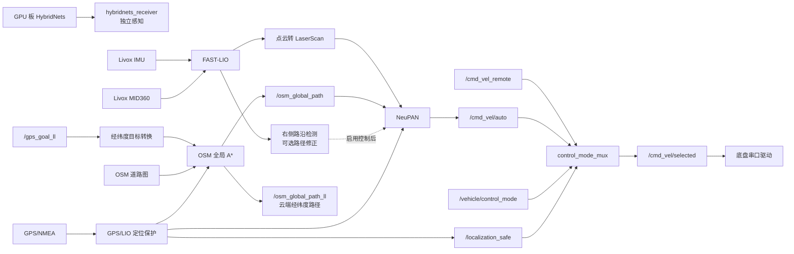

# NeuPAN 室内外导航项目分析

> 本文档用于帮助理解 `/home/nuc/lxw/neupan_ws` 的整体结构、运行链路和主要函数职责。
>
> 项目基于 ROS1 Noetic。`src/` 是源码，`build/` 和 `devel/` 是 catkin 生成物，通常不应直接修改。
>
> 以下控制链路以 `neupan_ros/example/lxw_car/launch/full_system_run.launch` 为准；其他测试 launch 可能仍直接使用 `/neupan_cmd_vel`。这是静态代码分析，不能代替实车运行检查。
>
> 最近核对：2026-10-08。分析使用 codegraph 定位核心类和函数，并以源码及 launch 中的实际订阅、发布、参数和 remap 为准。

## 1. 项目总体结构



系统可以分成六个层次：

1. **传感器层**：Livox、GPS、IMU；可选的相机和 GPU 板视觉接收。
2. **定位层**：FAST-LIO、GPS 投影、GPS/LIO 守门器、`map -> odom` 对齐。
3. **地图与全局规划层**：OSM 道路图、A*、Hybrid A*、栅格地图。
4. **局部规划与控制层**：NeuPAN 或室外直接路径跟踪器。
5. **底盘执行层**：串口底盘驱动。
6. **测试与可视化层**：RViz、日志、rosbag、路沿检测和 HybridNets 调试。

## 2. 关键运行链路

### 2.1 室内 NeuPAN

```text
Livox -> FAST-LIO -> /cloud_registered_body
      -> pointcloud_to_laserscan -> /scan

/odom 或 AMCL TF -> map -> base_link
/scan + TF + /initial_path
      -> neupan_core.py
      -> /cmd_vel/auto（本 launch 对 NeuPAN 输出的 remap）
      -> control_mode_mux.py（mode=0）
      -> /cmd_vel/selected
      -> base_driver_node.py
      -> MCU 串口
```

### 2.2 室外 NeuPAN

```text
GPS + FAST-LIO
      -> /odometry/gps、/odometry/local
      -> global_odom_bridge.py
      -> /odometry/global
      -> map_odom_align_bridge.py
      -> map -> odom TF

云端 /gps_goal_ll (sensor_msgs/NavSatFix)
      -> gps_goal_bridge.py -> /move_base_simple/goal (map 坐标)
      -> global_astar_node.cpp + OSM 道路图 + /odometry/global
      -> /osm_global_path (map 坐标，供 NeuPAN 跟踪)
      -> /osm_global_path_ll (经纬度 JSON，供云端显示)

/osm_global_path + /scan + TF -> neupan_core.py
      -> /cmd_vel/auto -> control_mode_mux.py（mode=0 且定位安全）
      -> /cmd_vel/selected -> base_driver_node.py -> MCU 串口
```

目标到达不等于立即运动：桥接节点会拒绝 NaN 经纬度和无效的 `NavSatFix.status.status`；A* 需要可用的全局里程计与 OSM 道路图，路径搜索也可能因道路吸附或不可达失败。NeuPAN 还需要有效扫描和 TF；自动模式下 `/localization_safe=false` 会使选择器输出零速度。

### 2.3 室外直接跟踪

```text
OSM A* -> /osm_global_path
       -> global_path_tracker.py
       -> /neupan_cmd_vel
       -> base_driver_node.py
```

这条测试链路不经过完整系统的 `control_mode_mux.py`。不要与完整系统同时启动同一个串口驱动或竞争同一底盘速度输入。

### 2.4 MID360 右侧路沿修正（可选）

```text
/cloud_registered_body -> lidar_curb_node.py
  -> /road_curb/lateral_error + /road_curb/status
  -> path_refine_node.py + /osm_global_path
  -> /osm_global_path_curb_refined
```

`enable_lidar_curb:=true` 只启动检测；还需 `enable_lidar_curb_control:=true` 才会把 NeuPAN 的初始路径切换到修正路径。默认两个开关都是 `false`。HybridNets 接收器是独立感知输入，当前不直接生成 NeuPAN 路径或底盘速度。

### 2.5 云端接口与手动接管

| Topic | 类型 | 云端方向 | 用途 |
| --- | --- | --- | --- |
| `/gps/fix` | `sensor_msgs/NavSatFix` | 订阅 | 原始 GPS 经纬度；不等同于融合后的 `/odometry/global` |
| `/osm_global_path_ll` | `std_msgs/String` | 订阅 | `data` 为 `{"points":[{"latitude":23.0398,"longitude":113.39002},...]}` 的 JSON；与 `/osm_global_path` 最终路径点一一对应 |
| `/gps_goal_ll` | `sensor_msgs/NavSatFix` | 发布 | 目标经纬度；默认拒绝 `status.status < 0` |
| `/vehicle/control_mode` | `std_msgs/UInt8` | 发布 | `0=AUTO`，`1=MANUAL`；默认 `0` |
| `/cmd_vel_remote` | `geometry_msgs/Twist` | 发布 | 云端手动速度；launch 把选择器内部 `/cmd_vel/remote` 订阅重映射到此 topic |
| `/vehicle/control_mode/status` | `std_msgs/String` | 订阅 | 当前模式及 `auto_active`、`remote_active`、`localization_unsafe` 等原因 |

自动时，NeuPAN 继续发布 `/cmd_vel/auto`，选择器仅在自动指令未超时且定位安全时转发；手动时 NeuPAN 不停止，但选择器只转发 `/cmd_vel_remote`。最终输出始终是 `/cmd_vel/selected`。自动/手动指令超时默认分别为 `0.5 s`/`1.0 s`，超时输出零速度。这里 `Twist.angular.z` 被底盘驱动解释为**前轮转向角（弧度）**，不是差速车的角速度。

完整系统把定位安全停车放在选择器的自动分支；手动模式不受 `/localization_safe` 拦截。使用 `use_global_ekf:=true` 时，本 launch 关闭选择器的这项定位门控；其他 launch 是否启用底盘自身的定位保护需单独检查。

模式消息与速度消息的超时处理不同：启动后从未收到模式消息时采用默认自动模式；收到有效模式后，即使模式发布端断开，也保留最后一次模式，不会自动切回自动。当前没有模式心跳超时。模式发布端应周期发布或使用 latch，以便新启动的订阅者取得当前模式。

### 2.6 控制状态的含义

| `status.data` 中的 `reason` | 实际行为 |
| --- | --- |
| `starting` | 节点刚启动；随后由定时器更新状态 |
| `auto_active` | 自动源及时且通过已启用的定位门控；仍可能转发零速度 |
| `auto_timeout` | 自动源不存在或超过自动超时，输出零速度 |
| `localization_unsafe` | 自动模式定位门控未通过，输出零速度 |
| `remote_active` | 手动源及时，转发其速度；仍可能转发零速度 |
| `remote_timeout` | 手动源不存在或超过手动超时，输出零速度 |

状态话题为 latched JSON 字符串，实际结构是 `{"mode":1,"mode_name":"MANUAL","reason":"remote_active"}`。`active` 只表示速度源可用，不保证车辆正在运动；还需看 `/cmd_vel/selected` 的数值及串口执行情况。

### 2.7 连续目标与桥底再次出发

系统持续运行时，云端可以依次向 `/gps_goal_ll` 下发多个目标。NeuPAN 到达当前路径终点后持续发布零自动速度，并显示 `Goal reached; waiting for a new goal/path`；`/goal_arrived` 是 latched `std_msgs/String`，默认 2 Hz 发布 `"1"`。接收新的地图目标后先清除旧到达状态并发布 `"0"`，停车等待 A* 新路径；新路径由主循环统一装载和重置规划器，避免订阅回调与求解器同时修改路径。旧任务路径的重复发布不会重新启动已完成任务。

NeuPAN 终端会把“已到达并等待新目标”“新目标已接收、等待规划路径”“新路径已接受并开始下一段”等任务生命周期关键提示显示为黄色；等待 `base_link -> map` 或激光雷达坐标系到 `map` 的 TF 变换提示显示为红色，便于现场观察。颜色只用于终端显示，不写入综合 JSONL 日志的数据字段。

完整系统启动时，Livox SDK 的常规初始化和 `Data Handler` 等驱动输出写入 ROS 日志文件，不持续占用综合启动终端；单独启动 `rviz_MID360.launch` 时默认仍输出到屏幕，方便驱动调试。NeuPAN 的雷达 TF 等待、雷达失效安全停车和障碍物触发停车继续在综合启动终端周期提示，不受该设置影响。

首次启动仍需稳定 GPS 建立定位基准；到达后不重启系统，新目标不会重置 `global_odom_bridge`。桥底 GPS 非 Fixed 时可使用已初始化的全局变换和本地里程计继续规划、行驶，但本地里程计、TF、LaserScan 与定位安全状态仍必须正常，续推预算也不能超限。保存并冻结上一次终点坐标不能替代当前本地里程计位置。

## 3. 根目录文件夹

### `src/`

所有 ROS 包和第三方源码的集合，是项目源码的主要入口。

### `build/`

catkin 编译目录，包含 CMake 缓存、构建规则、中间文件和生成的包构建目录。不要在这里修改源码。

### `devel/`

catkin 开发环境，包含 `setup.bash`、环境变量、Python 路径、动态库和 ROS 包索引。

### `bags/`

可自行创建的 rosbag 数据目录；当前工作区根目录没有该文件夹。录制话题配置位于 `src/vehicle_bag_recorder/config/vehicle_data.yaml`。

### `tracker_logs/`

系统运行 JSONL 日志，记录 GPS、定位、路径、控制和安全状态。

### 根目录 Markdown

- `README.md`：项目总体说明。
- `GDUT室外导航.md`：室外导航部署记录和说明。

## 4. `src/neupan_ros`

NeuPAN 的 ROS1 封装和示例工程。

### `src/neupan_ros/src/neupan_core.py`

核心类是 `neupan_core`。

- `__init__`：初始化 ROS 节点，读取规划器、LaserScan、TF、自车过滤和安全参数；加载 NeuPAN 配置；建立发布器和订阅器。
- `run`：50 Hz 主循环。读取 `map -> base_link` TF，检查路径和扫描健康状态，调用 NeuPAN，发布速度、路径、参考状态和 RViz Marker。
- `parse_adjust_profile`：把字符串形式的五元调参配置解析成 NumPy 数组。
- `mark_scan_valid`：记录扫描恢复时间和当前有效模式。
- `mark_scan_fault`：记录扫描故障并进入 `FAULT` 状态。
- `scan_is_healthy`：检查扫描是否存在、是否超时、TF 是否有效、是否已经稳定恢复。
- `publish_scan_health`：以 JSON 字符串发布 `/neupan/scan_health`。
- `compute_min_obstacle_distance`：计算机器人前方指定角度范围内的最近障碍距离。
- `update_adaptive_adjust_parameters`：按最近障碍距离，在 clear 和 avoid 两组 NeuPAN 参数之间插值。
- `scan_callback`：过滤无效距离、按角度和距离筛选、降采样，并把雷达点从 `lidar_frame` 转换到地图坐标。
- `path_callback`：接收完整 `nav_msgs/Path`，转换到 `map` 后交给规划器。
- `waypoints_callback`：从机器人当前位置和多个航点生成规划初始路径。
- `goal_callback`：从当前位姿和目标 Pose 生成规划初始路径。
- `quat_to_yaw_list`：将四元数数组转换为偏航角。
- `quat_to_yaw`：将 ROS Quaternion 转换为偏航角。
- `yaw_to_quat`：将偏航角转换为 ROS Quaternion。
- `generate_path_msg`：把 NeuPAN 内部路径转换成 `nav_msgs/Path`。
- `generate_twist_msg`：把 NeuPAN 动作转换成 `geometry_msgs/Twist`；到达或停止时输出零速度。
- `generate_dune_points_markers_msg`：发布 DUNE 点集 MarkerArray。
- `generate_nrmp_points_markers_msg`：发布 NRMP 点集 MarkerArray。
- `generate_robot_marker_msg`：根据机器人尺寸和运动学生成 RViz 车体 Marker。

主要输入话题：`/scan`、`/initial_path`、`/neupan_waypoints`、`/neupan_goal`。

主要输出话题：`/neupan_cmd_vel`、`/neupan_plan`、`/neupan_initial_path`、`/neupan_ref_state`、`/dune_point_markers`、`/nrmp_point_markers`、`/robot_marker`、`/neupan/scan_health`。

### `src/neupan_ros/scripts/neupan_node.py`

程序入口。实例化 `neupan_core`，然后调用 `run()`。

### `example/lxw_car`

真实阿克曼车辆示例。

- `config/neupan_config.yaml`：旧版默认配置入口。
- `config/neupan_config_indoor.yaml`：室内 NeuPAN 参数。
- `config/neupan_config_outdoor.yaml`：室外较保守参数。
- `config/neupan_train.yaml`：DUNE 训练参数。
- `dune_train_lxw_car.py`：加载训练配置并调用 `train_dune()`。
- `launch/neupan_lxwcar.launch`：真实车辆基础启动，包含底盘、FAST-LIO、Livox、点云转 LaserScan 和 NeuPAN。
- `launch/full_system_run.launch`：完整室内/室外系统入口，包含定位、GPS 经纬度目标桥接、OSM A*、NeuPAN、自动/手动速度选择、底盘，以及可选的路沿检测与 HybridNets 接收。
- `launch/outdoor_global_only_test.launch`：只测试室外定位和 OSM 全局规划。

### `example/lxw_car_simulation`

阿克曼车辆 Gazebo 仿真。

- `config/neupan_config_sim.yaml`：仿真规划参数。
- `scripts/ackermann_sim_driver.py`：接收速度指令，按阿克曼模型更新 Gazebo 车辆状态，发布里程计和 TF。
- `scripts/publish_demo_goal.py`：延时发布仿真目标。
- `launch/lxw_car_simulation.launch`：仿真总入口。
- `launch/neupan_lxwcar_gazebo.launch`：启动 Gazebo、车辆模型、RVO 动态障碍、仿真驱动、NeuPAN 和 RViz。
- `worlds/`、`models/`、`urdf/`、`rviz/`：仿真环境、车辆模型、机器人描述和显示配置。

### `example/gazebo_limo`

Limo 差速车仿真。

- `config/neupan_planner_limo.yaml`：循环路径配置。
- `config/neupan_planner_limo_noloop.yaml`：非循环路径配置。
- `dune_train_limo.yaml`：Limo DUNE 训练参数。
- `dune_train_limo.py`：Limo DUNE 训练入口。
- `launch/neupan_gazebo_limo.launch`：启动 NeuPAN 和 RViz。
- `launch/neupan_gazebo_limo_noloop.launch`：非循环版本。
- `launch/gazebo_limo_env_complex_20.launch`：启动复杂 Gazebo 环境和 RVO 动态障碍。
- `launch/run_limo_rviz.launch`：只启动模型状态发布和 RViz。

## 5. `src/robot_base_driver`

负责底盘串口、里程计、定位保护、路径跟踪和系统日志。

### `scripts/base_driver_node.py`

- `RobotBaseDriver.__init__`：读取串口、车体和安全参数，打开串口，建立速度订阅、里程计发布和 TF 广播；速度订阅由 `~cmd_topic` 指定，完整系统配置为 `/cmd_vel/selected`。
- `cmd_vel_callback`：把 `Twist.linear.x`（m/s）和 `Twist.angular.z`（转向角，rad）转换为 MCU 协议 `CMD,<轮速 rad/s>,<转角 deg>`；处理速度死区和 ±25° 转角限幅。
- `localization_safety_callback`：仅当本节点的 `~enable_localization_safety_stop=true` 时，定位不安全立即发送停车命令。完整系统将该参数设为 `false`，改由控制模式选择器仅保护自动模式；其他 launch 可有不同设置。
- `send_serial_command`：格式化并写入串口。
- `read_from_mcu`：读取 MCU 的 `ODO` 行，解析位置和航向，设置里程计零点，计算相对位姿和速度。
- 主循环：持续读取 MCU 数据并发布 `/odom`，必要时发布 `odom -> base_link` TF。

### `scripts/control_mode_mux.py`

- 订阅 `/vehicle/control_mode`、`/cmd_vel/auto` 和内部名称 `/cmd_vel/remote`。完整系统用 ROS remap 将后者接到云端 `/cmd_vel_remote`，不会额外创建 `/cmd_vel/remote` 发布话题。
- `AUTO=0`：选择 NeuPAN 自动速度；完整系统在 `use_global_ekf:=false` 的室外配置下同时检查 `/localization_safe`。定位不安全时立即输出零速度并报告 `localization_unsafe`。
- `MANUAL=1`：选择云端手动速度，不受定位安全状态拦截；超过默认 `1.0 s` 没有新遥控消息则输出零速度。
- 以约 20 Hz 发布选定速度到 `/cmd_vel/selected`，并在状态变化时发布 JSON 状态到 `/vehicle/control_mode/status`。无模式消息时采用 launch 默认的 `0=AUTO`；非法模式值会被忽略。

### `scripts/global_path_tracker.py`

室外不经过 NeuPAN 的直接路径跟踪器。

- `clamp`：限制数值范围。
- `wrap_to_pi`：把角度归一化到 $[-\pi, \pi]$。
- `GlobalPathTracker.__init__`：读取路径、里程计、目标、前视、速度、转角和停车参数。
- `path_callback`：缓存 `/osm_global_path`，计算路径累计长度并重置目标状态。
- `odom_callback`：接收全局里程计并提取位姿。
- `update_tf_pose`：当启用 TF 模式时读取当前机器人位姿。
- `goal_callback`：记录 RViz 点击目标。
- `publish_stop`：发布零速度。
- `_record_debug_sample`：发布 JSON 调试状态。
- `compute_cumulative_lengths`：计算路径每个点的累计弧长。
- `project_onto_path`：将机器人投影到最近路径段，得到横向误差、弧长和剩余距离。
- `segment_heading_at_projection`：计算投影位置处的路径切线方向。
- `find_target_point`：根据前视距离找到跟踪目标点。
- `should_stop_at_goal`：结合点击目标、路径末端和越界条件判断是否停车。
- 控制循环中的控制计算：根据横向误差和航向误差计算 Ackermann 转角，根据距离目标的远近调整速度。

### `scripts/gps_fix_to_map_odom.py`

- `latlon_to_xy`：把经纬度转换到以 datum 为原点的局部平面坐标。
- `fix_cb`：缓存 `NavSatFix`。
- `heading_cb`：缓存航向。
- `build_covariance`：从 GPS 协方差构造里程计协方差。
- `timer_cb`：周期发布 `/odometry/gps`。

### `scripts/global_odom_bridge.py`

GPS 与 FAST-LIO 的全局定位安全守门器。

- GPS、LIO、GGA、航向回调：缓存各类定位和质量数据。
- `data_quality`：检查 fix 状态、GGA 质量、卫星数、HDOP 和位置协方差。
- `candidate_transform`：根据 GPS 与局部里程计计算候选 `map -> odom` 变换。
- `transform_error`：计算候选变换与当前变换的误差。
- `candidates_consistent`：检查连续候选是否稳定一致。
- `append_recovery_candidate`：加入 GPS 恢复候选窗口。
- `recovery_window_stable`：判断恢复窗口是否满足稳定时间。
- `set_mode`：切换 GPS 跟踪、GPS 丢失、本地续推和恢复状态。
- `update_guard`：更新 GPS 跟踪、丢失、本地续推等状态；定时回调随后发布 `/odometry/global`、`/gps_guard/status` 和 `/localization_safe`。

`localization_is_safe` 的条件是：全局与本地变换已初始化、本地里程计未超时、已过本地异常观察期，并且本地续推距离和时间预算未超限。GPS 暂时失锁后，如果已初始化且本地续推正常，定位安全状态仍可能为 `true`；它不等价于“此刻 GPS 必须为 RTK Fixed”。启动时缺少 GPS 或本地里程计则无法完成初始化。

续推试运行限制默认是累计路程 100 米或持续 600 秒（10 分钟），任一达到便将 `/localization_safe` 置为 `false`；这只是限制未校正里程计累积时间/距离，不能保证实际漂移小于某个米数。停车等待也计时，路程按每次本地位姿增量累计，因此往返运动不能抵消；新目标、到达、短暂 GPS Fixed 和里程计原点重置都不会清零预算。只有可信 GPS 完成初始化或平滑恢复到 `GPS_TRACKING` 才重置。距离和时间需用现场数据调整。

### `scripts/lio_odom_guard.py`

FAST-LIO 输出保护器。

- `pose_from_odom`：提取里程计位置和偏航角。
- `assess_motion`：检查平面速度、横向速度、角速度和采样间隔。
- `apply_offset`：对 LIO 位姿施加当前对齐偏移。
- `align_offset`：重新计算 LIO 与轮速之间的偏移。
- `wheel_extrapolated_target`：根据轮速里程计外推目标位姿。
- `publish_corrected`：发布保护后的 LIO 里程计。
- `lio_cb`、`wheel_cb`：处理 FAST-LIO 和轮速输入。

### `scripts/map_odom_align_bridge.py`

- `_global_cb`：缓存全局里程计。
- `_local_cb`：缓存局部里程计。
- `_timer_cb`：根据全局和局部里程计实时计算并广播 `map -> odom`。

### `scripts/system_run_logger.py`

- `topic_map`：定义需要记录的话题集合。
- `open_log_file`：创建 JSONL 日志文件。
- `write_record`：写入单条记录。
- 各类 `*_cb`：缓存 GPS、GGA、航向、里程计、控制、路径、安全状态、云端经纬度目标、地图目标和到达状态。
- `record_navigation_event`：每次收到目标和路径立即写事件；完整米制/经纬度路径只写事件，不在每个采样中重复。到达状态首次收到或发生变化时也写事件，附带当时目标、GPS、航向、融合位姿、安全状态及数据接收时间，便于回溯各段任务；接收目标不代表目标已通过校验或已成功规划。
- `timer_cb`：默认 10 Hz 写综合状态，含各字段数据年龄；目标、路径摘要和持续发布的到达 `0/1` 一并采样。原始 GPS 与融合位姿分开记录，桥底不能把原始 GPS 当作可信融合定位。
- 日志位置：`tracker_logs/system_run_full_*.jsonl`，每行独立 JSON。默认 `max_file_size_mb=0`，不限制文件大小，持续写入直到系统退出；请关注磁盘剩余空间。若主动配置正数上限，达到上限后停止追加普通记录并告警。

### `config/` 和 `launch/`

包含底盘串口、EKF、GPS、LIO 守门、导航核心和 TF 启动配置。启动文件决定哪些节点同时运行，是排查 TF 冲突和重复控制器的首要位置。

## 6. `src/osm_map_handler`

负责 OSM 道路图加载、道路吸附、A* 全局路径和 GPS 目标转换。

### `src/global_astar_node.cpp`

核心类通常为 `OSMGraphAStarPlanner`。

- `loadGraph`：读取 OSM XML，过滤道路并建立节点、边和道路属性。
- `latLonToXY`：经纬度转换到局部地图坐标。
- `projectPointToSegment`：将点投影到道路线段。
- `findNearestGraphPoint`：寻找最近道路图位置，用于起点/终点吸附。
- `buildGraphPath`：在道路图上执行 A* 搜索。
- `applyRightLaneOffset`：根据道路宽度、行驶方向和车道参数把中心线偏移到右侧车道。
- `computeTurnAngle`：计算连续路径段的转角。
- `spacingFromTurnAngle`：根据转角决定路径采样间距。
- `resamplePathForTracking`：生成适合车辆控制的稠密路径。
- `buildLatLonPathMessage`：把最终 `current_path_` 的所有路径点按与 GPS 投影相同的原点反算为经纬度，按原顺序生成 JSON。
- `prepareGoalRequest`：准备当前起点和目标请求。
- `cacheGoalRequest` / `tryPendingGoal`：定位或道路图未准备好时保留最新目标；新目标覆盖旧缓存，定时器在条件就绪后自动规划。道路不可达等规划失败不会高频重复尝试。
- `processGoal`：执行吸附、搜索、偏移、重采样并发布最终路径。
- `mapCallback`：接收地图或地图数据。
- `odomCallback`：接收机器人位姿。
- `gpsCallback`：接收 GPS。
- `goalCallback`：处理 RViz 或外部目标。
- `clickedPointCallback`：处理 RViz 点击点。
- `timerCallback`：维护 GPS Marker 和目标超时状态。

主要输出：`/osm_global_path`（`nav_msgs/Path`，`map` 坐标米制路径）、`/osm_global_path_ll`（`std_msgs/String`，JSON 经纬度路径）、`/osm_vector_map`、`/hybrid_astar_subgoal`、`/initialpose`。两条路径只在成功规划后发布，均为 latched topic；经纬度路径不是 `nav_msgs/Path`，不要把经纬度写进 `Pose.position.x/y`。

经纬度输出保留小数点后 8 位，转换对象是道路吸附、右侧偏移和重采样后的最终路径，不是 A* 搜索中访问过的全部候选节点。JSON 当前只有 `points`，没有路径 ID、时间戳、海拔或朝向；需要判断是否为新规划时，应结合原 `/osm_global_path.header.stamp` 和规划器日志。

### `scripts/gps_goal_bridge.py`

订阅 `/gps_goal_ll`（`sensor_msgs/NavSatFix`），以启动参数配置的地图原点把经纬度目标转换为 `map` 坐标的 `PoseStamped`，发布到 `/move_base_simple/goal`；拒绝 NaN 经纬度和默认配置下 `status.status < 0` 的目标。该桥接节点由完整系统的 `enable_gps_goal_bridge` 控制，默认启用。

### `scripts/osm_alignment_analyzer.py`

离线分析 GPS 轨迹与 OSM 道路的对齐误差。

- `load_osm_segments`：加载道路线段。
- `load_points`：读取 GPS 或测试点。
- `nearest_segment`：寻找每个点的最近道路段。

## 7. `src/lidar_curb_refinement`

MID360 右侧路沿检测与可选路径修正。它使用 FAST-LIO 去畸变后的点云，不依赖机械式雷达的固定扫描线编号。

### `scripts/lidar_curb_node.py`

- 订阅 `/cloud_registered_body`，经 TF 转到 `base_link`，在车体右前方高程栅格检测连续的上台阶。
- 发布 `/road_curb/right_edge`、`/road_curb/lateral_error`、`/road_curb/status`，以及可选的 ROI 和候选点云。
- 右侧在 `base_link` 的 `y<0`；状态无效或 TF 不可用时不会把该帧当成有效路沿。

### `scripts/path_refine_node.py`

- 订阅 `/osm_global_path`、`/road_curb/lateral_error` 和 `/road_curb/status`。
- 根据路径行进方向的右法向量调整路径，按最大偏移量限幅，对有效误差平滑，对失效误差衰减。
- 完整系统配置输出 `/osm_global_path_curb_refined`；原 `/osm_global_path` 不被就地修改。

### `scripts/curb_run_logger.py` 和 `launch/road_curb_debug.launch`

可独立记录路沿状态、误差和修正路径。完整系统中 `enable_lidar_curb` 控制检测节点，`enable_lidar_curb_control` 控制路径修正及 NeuPAN 跟踪修正路径；仅打开后者而未打开前者时，没有修正路径发布者。

## 8. `src/hybrid-a-star-annotation`

带车辆运动学约束的 Hybrid A* 路径规划器。

主要调用关系：

```text
Planner::plan
  -> Algorithm::hybridAStar
  -> Node3D / Node2D
  -> CollisionDetection
  -> Smoother
  -> Path / RViz 发布
```

- `planner.cpp`：ROS 规划器总控。
  - `initializeLookups`：初始化 Dubins 和碰撞查找表。
  - `setMap`、`setStart`、`setGoal`：更新地图、起点和终点。
  - `plan`：执行搜索、路径回溯、平滑和发布。
- `algorithm.cpp`：核心搜索。
  - `hybridAStar`：三维状态空间搜索，状态包含位置和朝向。
  - `aStar`：二维栅格搜索，用于启发式代价。
  - `updateH`：融合二维 A* 与 Dubins/Reeds-Shepp 启发式。
  - `dubinsShot`：尝试直接用曲线连接当前节点和目标。
- `node2d.cpp/.h`：二维节点的索引、代价、开放/关闭状态和邻居生成。
- `node3d.cpp/.h`：带方向角的车辆节点和运动学后继生成。
- `collisiondetection.cpp/.h`：车辆轮廓栅格化和碰撞检查。
- `smoother.cpp/.h`：路径回溯、障碍代价、曲率代价和平滑度代价。
- `path.cpp/.h`：路径段、节点和车辆 Marker 的生成。
- `visualize.cpp/.h`：搜索节点、代价和热力图可视化。
- `dynamicvoronoi.cpp/.h`：动态 Voronoi 距离场。
- `dubins.cpp/.h`：Dubins 曲线长度、采样和子路径计算。
- `tf_broadcaster.cpp`：发布规划相关 TF。
- `main.cpp`：ROS 节点入口。

## 9. `src/FAST_LIO`

Livox 点云与 IMU 融合定位系统。

### `src/laserMapping.cpp`

- `main`：读取参数，初始化 ROS 发布器、订阅器、预处理器和 EKF。
- `standard_pcl_cbk`：接收标准 PointCloud2。
- `livox_pcl_cbk`：接收 Livox 点云。
- `imu_cbk`：缓存 IMU 数据。
- `sync_packages`：同步 IMU 和点云时间段。
- `h_share_model`：构造点到地图平面的 EKF 残差和雅可比。
- `map_incremental`：把当前有效点加入 ikd-Tree 地图。
- `lasermap_fov_segment`：维护当前视野内的局部地图。
- `pointBodyToWorld`：机体坐标点转换到世界坐标。
- `publish_frame_world`、`publish_frame_body`：发布世界/机体坐标点云。
- `publish_effect_world`：发布参与匹配的有效点。
- `publish_map`：发布地图点云。
- `publish_odometry`：发布 `/Odometry`。
- `publish_path`：发布 FAST-LIO 轨迹。

### `src/preprocess.cpp`

- `process(CustomMsg)`：处理 Livox 自定义消息。
- `process(PointCloud2)`：处理标准 ROS 点云。
- `avia_handler`、`oust64_handler`、`velodyne_handler`、`sim_handler`：不同雷达类型的数据解析。
- `give_feature`：提取平面和边缘特征。
- `plane_judge`：平面特征判断。
- `edge_jump_judge`：边缘跳变判断。

### `src/IMU_Processing.hpp`

类 `ImuProcess`：

- `Reset`：重置初始化状态。
- `set_extrinsic`：设置 LiDAR 与 IMU 外参。
- 协方差 setter：设置陀螺仪、加速度计和过程噪声。
- `IMU_init`：估计重力方向和 IMU 偏置。
- `UndistortPcl`：使用 IMU 运动补偿点云畸变。
- `Process`：完成 IMU 初始化、预积分和点云去畸变。

### `include/`

- `ikd-Tree/`：动态 KD-Tree，负责地图近邻搜索、插入、删除和重建。
- `IKFoM_toolkit/`：流形上的迭代误差状态 EKF 工具。
- `matplotlibcpp.h`：第三方 matplotlib C++ 封装。
- `common_lib.h`、`use-ikfom.hpp`、`so3_math.h`：状态、旋转和公共数学工具。

## 10. `src/livox_ros_driver2` 与 `src/Livox-SDK2`

这两部分属于 Livox 底层驱动和官方 SDK，主要用于设备通信，不是导航策略代码。

### `livox_ros_driver2`

- `livox_ros_driver2.cpp`：ROS1/ROS2 入口，读取设备和输出格式参数。
- `driver_node.cpp/.h`：管理 LDDC、LDS、雷达线程和 ROS 发布。
- `lds.cpp/.h`：雷达数据缓存、队列和退出控制。
- `lds_lidar.cpp/.h`：雷达初始化、配置、回调绑定和释放。
- `lddc.cpp/.h`：从 SDK 队列读取数据并发布 PointCloud2、CustomMsg、PCL 和 IMU。
- `comm/`：队列、信号量、缓存、数据解包和拼帧。
- `parse_cfg_file/`：JSON 配置读取。
- `call_back/`：Livox SDK 数据和设备状态回调。
- `msg/`：Livox 自定义 ROS 消息。
- `launch_ROS1/`、`launch_ROS2/`：不同 ROS 版本启动文件。
- `3rdparty/rapidjson/`：第三方 JSON 库。

### `Livox-SDK2`

官方 SDK：

- `sdk_core/`：设备发现、网络通信、协议解析、日志和设备控制。
- `include/`：公开 API 和协议结构。
- `samples/`：官方示例。
- `3rdparty/`：SDK 依赖。
- `build/`：SDK 编译产物。

排查雷达连接、设备发现、协议或丢包问题时才需要深入阅读这里。

## 11. `src/rvo_ros`

Gazebo 动态障碍物和 RVO 避碰仿真。

- `src/rvo_node.cpp`：ROS 节点入口，读取 Gazebo 模型状态、运行 RVO 并提供目标服务。
- `rvo_lib/nav_rvo.cpp`：RVO ROS 封装。
  - `setupScenario`：设置邻居距离、时间视界、半径和最大速度。
  - `setGoal`：设置固定目标。
  - `randomOnceGoal`、`randGoal`：生成随机目标。
  - `arrived`：判断 agent 是否到达目标。
  - `setInitial`：判断 agent 是否初始化完成。
  - `setPreferredVelocities`：计算朝向目标的期望速度。
  - `updateState_gazebo`：将 Gazebo ModelStates 转成 RVO 状态。
  - `step`：执行邻居搜索和新速度求解。
- `Agent.cpp/.h`：单个 agent 的 ORCA 约束和速度求解。
- `RVOSimulator.cpp/.h`：RVO 仿真器和时间步进。
- `KdTree.cpp/.h`：空间索引和邻居查询。
- `Obstacle.cpp/.h`：障碍物表示。
- `Vector2.h`：二维向量运算。
- `formation.cpp`：队形辅助。
- `set_goals_client.cpp`：调用设置目标服务。
- `srv/SetGoals.srv`：设置动态障碍物目标。
- `simulation/`：Gazebo 世界、插件和资源。

## 12. `src/pcd2pgm_package`

将 PCD 点云转换为二维栅格地图。

主要文件 `pcd2pgm/pcd2pgm.cpp`：

- `PassThroughFilter`：按高度范围过滤点。
- `RadiusOutlierFilter`：剔除稀疏离群点。
- `SetMapTopicMsg`：根据点云范围和分辨率生成 `nav_msgs/OccupancyGrid`。
- `main`：读取参数、执行点云滤波并发布地图。

## 13. `src/teb_test`

把 OSM 全局路径接入 `move_base`/TEB。

### `src/osm_path_planner.cpp`

核心类 `OSMPathPlanner : nav_core::BaseGlobalPlanner`：

- `initialize`：读取路径话题、坐标系、超时和匹配容差。
- `makePlan`：等待与当前 `move_base` 请求匹配的 `/osm_global_path`，返回计划。
- `pathCallback`：缓存 OSM 路径。
- `isUsablePlan`：检查路径时间戳、起点误差和终点误差。

`plugins.xml` 负责向 `move_base` 注册该全局规划插件，`config/` 和 `launch/` 保存 TEB、costmap 和 move_base 参数。

## 14. `src/wheeltec_gps_driver`

NMEA GPS 驱动和 GPS 辅助工具。

### `src/libnmea_navsat_driver/parser.py`

- `safe_float`、`safe_int`：安全数值转换。
- `convert_latitude`、`convert_longitude`：NMEA 度分格式转十进制度。
- `convert_time`、`convert_time_rmc`：解析 NMEA 时间。
- `convert_status_flag`：解析定位状态。
- `convert_knots_to_mps`：节转换为米每秒。

### 其他文件

- `checksum_utils.py`：校验 NMEA checksum。
- `driver.py`：类 `RosNMEADriver`，将 NMEA 解析结果转换成 ROS 消息并发布。
- `nmea_serial_driver.py`：串口读取 NMEA。
- `nmea_socket_driver.py`：UDP 接收 NMEA。
- `nmea_topic_driver.py`：订阅原始 NMEA 话题并解析。
- `nmea_topic_serial_reader.py`：串口读取并发布原始 NMEA 话题。
- `gps_path.cpp`：接收 GPS、累计 GPS 路径并发布相关 TF。
- `test/test_driver.py`：使用 rosbag 检查 GPS 驱动输出。

其中 `libnmea_navsat_driver` 基于通用 NMEA 驱动改动，阅读时应区分通用代码和本地修改。

## 15. `src/Test`

车辆开环测试和数据记录。

### `scripts/open_loop_motion.py`

- `speed_scale`：调整测试速度。
- `steering_at`：设置不同阶段的转角。
- `publish_stop`：发布停车指令。
- `wait_for_required_sources`：等待 GPS、定位等必要输入。
- 主循环：向 `/neupan_cmd_vel` 发布开环控制并发布运动状态。

### `scripts/open_loop_data_logger.py`

- `build_packet`：构造 GPS、里程计、控制量和状态的综合记录。
- `packet_sources_ready`：检查数据源是否完整。
- `write_record`：写入 JSONL 文件。
- 各类回调：缓存 GPS、航向、三类里程计、控制和运动状态。

## 16. 相机与 GPU 板视觉接收

### `src/usb_camera`

本地 USB Camera3 的 ROS1 启动、180° 图像旋转和标定配置。`camera.launch` 默认从 `/dev/video0` 读取图像，发布 `/camera/image_raw` 和 `/camera/camera_info`；相机标定和雷达相机外参另有独立 launch。不要把它与 GPU 板接收器对同一 `/dev/video0` 的使用混为一条数据链。

### `src/hybridnets_receiver`

接收 GPU 板的 H.264/RTP 视频和推理 JSON，分别发布 `/camera/remote_image_raw` 与 `/hybridnets/result_json`；可选调试叠加 `/hybridnets/debug_image` 和 MP4/JSONL 录制。完整系统默认启动接收器，但它目前不向 NeuPAN 提供路径，也不发布底盘控制命令。

## 17. 其他源码与资源包

### `src/nmea_msgs-master`

ROS NMEA 消息定义包，主要提供消息类型。

### `src/models` 与 `src/neupan_ros/example/lxw_car_simulation/urdf`

模型资源和仿真车辆描述；TF 与车体尺寸需要结合对应 launch 和 URDF 核对。

### `src/FAST_LIO/Log`、`PCD`、`rviz_cfg`

FAST-LIO 运行日志、点云数据和 RViz 配置。

### 各包的 `CMakeLists.txt` 和 `package.xml`

- `package.xml`：定义 ROS 包名、依赖和运行时依赖。
- `CMakeLists.txt`：定义消息生成、编译目标、链接库、脚本安装和测试。
- launch 文件：决定节点、参数、话题 remap、TF 和启动条件。

### `src/vehicle_bag_recorder`

`scripts/bag_recorder.py` 的 `BagRecorder` 读取 YAML 配置，启动官方 `rosbag record`，监控磁盘空间及必录话题，结束时发送 SIGINT 等待 rosbag 完成索引。`config/vehicle_data.yaml` 是车辆数据配置，`config/hybridnets_data.yaml` 是视觉接收配置；输出包含 bag 和 JSON 清单。该工具只记录数据，不产生车辆控制指令。

```bash
roslaunch vehicle_bag_recorder record.launch
```

详细配置和存储目录以 [vehicle_bag_recorder/README.md](src/vehicle_bag_recorder/README.md) 为准。

## 18. 重点配置概念

### NeuPAN 配置

- `receding`：预测步数。
- `step_time`：模型时间步长。
- `ref_speed`：参考速度。
- `robot.kinematics`：`acker` 或 `diff`。
- `robot.wheelbase`：阿克曼轴距。
- `robot.max_speed`、`robot.max_acce`：速度和动作变化限制。
- `ipath`：初始路径间隔、曲线类型、循环和到达阈值。
- `pan`：DUNE/NRMP 迭代和模型参数。
- `adjust`：路径跟踪和避障权重。

### 定位安全配置

主要位于 `full_system_run.launch`：

- GPS fix 状态、GGA quality、卫星数、HDOP 和位置协方差门限。
- GPS 航向跳变和位置跳变门限。
- GPS 丢失后的本地续推时间。
- GPS 恢复所需稳定时间。
- FAST-LIO 速度、横向速度、角速度和采样间隔门限。

### 控制模式与定位保护

- `default_control_mode=0`：启动后默认自动；云端通过 `/vehicle/control_mode` 发 `1` 切换手动，`0` 切回自动。
- `auto_command_timeout=0.5`、`remote_command_timeout=1.0`：所选速度源超时后输出零速度。
- `gps_guard_dead_reckoning_max_distance_m=100.0`、`gps_guard_dead_reckoning_max_duration_sec=600.0`：续推预算。超限后自动模式停车，手动模式仍按已有遥控与超时规则处理；这些参数用于默认 `use_global_ekf=false` 的全局定位桥。
- 完整系统在室外且 `use_global_ekf=false` 时，仅对自动速度启用 `/localization_safe` 门控；底盘节点自身的定位门控在该 launch 中关闭。手动模式仍保留遥控指令超时停车。
- 目标转换与 OSM、GPS 投影必须共用 `map_origin_lat/lon` 与 `datum_lat/lon`，否则云端目标和路径会出现系统性偏移。

### 路沿与 GPU 板接收

- `enable_lidar_curb` 启动 MID360 右侧路沿检测；`enable_lidar_curb_control` 决定是否让 NeuPAN 跟踪 `/osm_global_path_curb_refined`。控制开关应在检测有效、方向和净距标定完成后启用。
- 路沿参数主要是右侧 ROI、上台阶高度、连续确认帧数、期望净距、最大修正量和误差平滑。
- `enable_hybridnets_receiver=true` 默认启动 GPU 板视频/JSON 接收；`show_hybridnets_overlay` 只控制调试显示。当前 HybridNets 结果不直接影响运动控制。

## 19. 当前项目的主要风险

1. **速度输入唯一性**：完整系统中底盘只订阅 `/cmd_vel/selected`，NeuPAN 被 remap 到 `/cmd_vel/auto`。其他测试 launch 或开环脚本可能仍发布 `/neupan_cmd_vel`，不要同时启动第二个串口底盘驱动或把多个源接到同一最终输入。
2. **TF 冲突**：多个 launch 可能同时发布 `map -> odom`、`odom -> base_link` 或传感器外参。
3. **传感器重复启动**：Livox、FAST-LIO、USB 相机或 HybridNets 接收器若由多个 launch 启动，可能出现重复节点、端口占用或重复话题。
4. **GPS 恢复跳变**：GPS 从失锁恢复时必须经过质量、连续稳定和位置/航向跳变检查。
5. **LaserScan 安全停机**：扫描缺失、TF 不可用或数据长期被过滤时，NeuPAN 应保持停车。
6. **目标消息与道路可达性**：`/gps_goal_ll` 无效状态、经纬度错误、缺少全局里程计或目标远离可行驶道路时，不会生成新路径。
7. **遥控端全零或失联**：`/cmd_vel_remote` 连接存在并不代表有非零运动指令；手动源超过 1 秒不更新会输出零速度。
8. **定位安全适用范围**：完整系统自动模式因 `/localization_safe=false` 停车，手动模式不会被此条件拦截；切换模式前应检查操作区域和遥控指令。
9. **路沿/视觉误检**：MID360 右侧路沿是可选路径修正，GPU 板 HybridNets 目前仅用于接收与显示；不能把视觉 JSON 当成已经接入控制的参考线。

## 20. 推荐阅读顺序

1. `src/neupan_ros/example/lxw_car/launch/full_system_run.launch`
2. `src/neupan_ros/src/neupan_core.py`
3. `src/osm_map_handler/scripts/gps_goal_bridge.py` 与 `src/osm_map_handler/src/global_astar_node.cpp`
4. `src/robot_base_driver/scripts/control_mode_mux.py` 与 `src/robot_base_driver/scripts/base_driver_node.py`
5. `src/robot_base_driver/scripts/global_odom_bridge.py`
6. `src/robot_base_driver/scripts/global_path_tracker.py`（仅直接跟踪测试链路）
7. `src/lidar_curb_refinement/README.md` 与 `src/hybridnets_receiver/README.md`
8. FAST-LIO、Livox 驱动及各包的 `config/`、`launch/`、`package.xml`、`CMakeLists.txt`

## 21. 推荐调试方法

### 查看节点和话题

```bash
rosnode list
rostopic list
rostopic info /gps_goal_ll
rostopic info /cmd_vel_remote
rostopic info /cmd_vel/selected
rostopic info /scan
```

### 查看 TF

```bash
rosrun tf view_frames
rosrun tf tf_echo map base_link
rosrun tf tf_echo map odom
```

### 查看关键状态

```bash
rostopic echo /neupan/scan_health
rostopic echo /gps_guard/status
rostopic echo /localization_safe
rostopic echo /vehicle/control_mode/status
rostopic echo /road_curb/status
rostopic echo /hybridnets/result_json
```

### 收到云端目标但车辆不动

按顺序检查；`/gps_goal_ll` 和 `/move_base_simple/goal` 是事件消息，需先运行 `rostopic echo` 再由云端发送新目标。前一步无数据时，先解决该步，再检查后续：

```bash
rostopic echo -n 1 /gps_goal_ll             # 目标经纬度及 status.status
rostopic echo -n 1 /move_base_simple/goal    # 经纬度转出的 map 目标
rostopic echo -n 1 /osm_global_path          # A* 米制路径
rostopic echo -n 1 /osm_global_path_ll       # 同一路径的经纬度 JSON
rostopic echo -n 1 /vehicle/control_mode/status
rostopic echo -n 1 /localization_safe        # 自动模式需要 true
rostopic echo -n 1 /cmd_vel/auto             # NeuPAN 原始自动速度
rostopic echo -n 1 /cmd_vel/selected         # 最终送往串口底盘的速度
```

`/osm_global_path` 和 `/osm_global_path_ll` 为 latched；若一次目标未生成新路径，可能仍看到上一次规划结果，应结合消息时间戳、规划器日志和目标变化判断。手动接管时还要查看 `/cmd_vel_remote_raw`（若云端提供）、`/cmd_vel_remote`，并确认 `status.reason=remote_active`；ROS remap 后不要期待存在独立的 `/cmd_vel/remote` 发布者。最终速度非零但车不动时，检查底盘串口连接、死区与 MCU 状态。

底盘速度死区为 `abs(linear.x) < 0.05 m/s`，落入死区时速度和转向都归零。最终速度非零也不意味着串口发送成功：串口打开失败时驱动仍可能注册为 ROS 节点，应检查 `Connected to serial port`、`Failed to connect to serial port` 或 `Serial write failed` 日志。

### 单独验证手动接收

已启动 ROS Master 和云端发布端时，可以启动一个只输出测试话题的选择器：

```bash
rosrun robot_base_driver control_mode_mux.py \
  __name:=control_mode_mux_test \
  /cmd_vel/remote:=/cmd_vel_remote \
  /vehicle/control_mode:=/vehicle/control_mode_test \
  _default_mode:=1 _remote_timeout:=1.0 \
  _output_topic:=/cmd_vel/selected_test \
  _status_topic:=/vehicle/control_mode/status_test
rostopic echo /cmd_vel/selected_test
```

这能核对云端 `Twist` 是否被选择器接收及超时归零。完整系统运行检查还需确认 `/cmd_vel_remote` 的订阅者包含 `/control_mode_mux`，以及 `/cmd_vel/selected` 的订阅者包含 `/robot_base_driver`；仅在 `rostopic list` 中看到 topic 名不能证明有在线发布者或新消息。

### 路沿检测测试

```bash
source /opt/ros/noetic/setup.bash
source devel/setup.bash
roslaunch lidar_curb_refinement road_curb_debug.launch
```

先观察 `/road_curb/status`、`/road_curb/right_edge`、`/road_curb/lateral_error` 和两路调试点云，再决定是否启用 `enable_lidar_curb_control`。

### 录包复测

重点记录：

```text
/gps/fix
/gps_goal_ll
/odometry/global
/localization_safe
/vehicle/control_mode
/vehicle/control_mode/status
/cmd_vel_remote
/cmd_vel/auto
/cmd_vel/selected
/osm_global_path
/osm_global_path_ll
/road_curb/status
/road_curb/lateral_error
/osm_global_path_curb_refined
/hybridnets/result_json
/scan
/tf
/tf_static
```

### G90 位置与双天线定向状态（2026-10-14）

NMEA 驱动额外解析设备已有的 `#PVTSLNA`，并校验 Unicore CRC32。
协议依据：N4 Products Commands and Logs Reference Book V2 R1.2，
7.3.23 节表 7-81。位置类型 `bestpos_type` 与定向类型 `heading_type`
是独立字段；不能用 GGA 固定解状态代替定向固定状态。

新增 `/gnss/solution_status`（`std_msgs/String`，JSON），包含
`position_type`、`position_fixed`、经纬度、`heading_type`、
`heading_fixed`、`heading_valid`、基线长度、航向角与定向卫星数。
该状态已加入系统日志及 `/gps_guard/status`。

默认只在定向类型为 `NARROW_INT`、基线大于零且定向卫星数大于零时
允许 HDT 发布 `/heading`；状态超过 2.5 秒未更新、缺失或报文校验错误时
拒绝航向。正常真北零度在定向有效时仍可发布。参数为
`require_heading_fixed` 和 `solution_timeout_sec`，可在 `g90_nmea.launch`
以及 GPS NMEA 驱动 launch 中设置。

定位保护独立检查定向状态，位置仍通过 GGA=4、协方差、HDOP、卫星数等
条件判断。默认高精度启动仍要求可靠位置和航向；已初始化后 GPS 退化继续沿用
已有本地续推及 100 米/600 秒限制。此改动不使用不可靠位置进行全局校正，
也不新增仅靠 GNSS 航向校正桥底续推的功能。

验证包含真实无解报文、位置/定向独立组合、CRC 错误、截断、非有限数值、
无效基线、航向零度及状态超时；固定解正例使用合成报文，仍需室外实测。
观察命令：`rostopic echo /gnss/solution_status`。

新增 `low_precision_startup` 开关，默认 false，完整系统使用
`roslaunch neupan_ros full_system_run.launch outdoor_mode:=true low_precision_startup:=true`
开启。仅在初次初始化允许较粗的位置（GGA 1/2/4/5、至少 6 颗卫星、HDOP≤5、
水平协方差≤100 m²），定向固定/有效、新鲜度、本地里程计及航向跳变保护仍必需。
保留 2 秒稳定确认，低精度位置候选相对均值散布≤2 米，优先采用满足条件的高精度初始化。
低精度初始化一次建立地图参考后进入本地续推，不持续追随低质量 GPS，预算从初始化
开始按原有 100 米/600 秒累计。可靠 RTK 恢复仍经过原有稳定确认和平滑校正。
`/gps_guard/status` 新增开关、初始化精度、当前全局参考精度及低精度阈值，随状态入日志。
开关经 `full_system_run.launch` / `outdoor_global_only_test.launch` 传入
`navigation_core.launch` 的稳定定位分支；不适用于 `use_global_ekf=true`。
固定航向不会消除粗 GPS 的地图平移误差，实车验证仍需关注路网对齐和到达偏差。

## 22. 一句话总结

这是一个把 GPS、FAST-LIO、Livox、OSM、NeuPAN、控制模式选择器和串口底盘整合在 ROS1 中的室内外导航系统：云端可下发经纬度目标并订阅经纬度路径；自动模式由 NeuPAN 控制并受定位安全保护，手动模式使用云端速度；MID360 路沿修正和 HybridNets 接收分别作为可选路径参考与独立感知输入。
